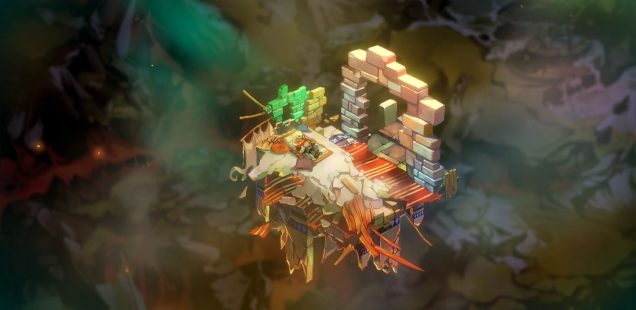
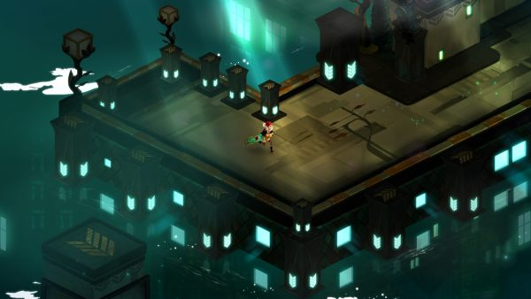
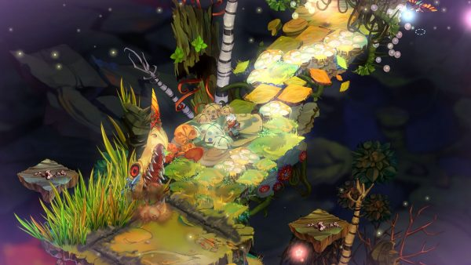

+++
title = "Playing For Real: A Tale of Two Calamities"
template = "mirror.html"
extra.source_url = "http://www.haywiremag.com/columns/playing-for-real-a-tale-of-two-calamities/"
extra.resolved_url = "https://haywiremag.com/columns/playing-for-real-a-tale-of-two-calamities/"
extra.captured = "2026-10-20"
extra.kind = "article"
extra.raw_response = "source.html.txt"
+++

### Jesse Porch tears things down and puts ‘em back together.

A few months ago, I [wrote](https://haywiremag.com/columns/playing-for-real-not-with-a-bang-but-a-winter/) about how the apocalypse can be used in storytelling as a powerful means of conveying the “true” nature of a world by stripping away distractions—how, despite being a story about the end of the world, the destruction is ultimately not the focus, but a lens through which the truth may be glimpsed more clearly. This month I’ll apply the same model to two substantively similar apocalyptic tales, examining how they use the details of their respective apocalypses to illuminate important elements of the worlds they’re set in. Interestingly, while both stories have radically different setting and tone, they address many of the same themes, illustrating how versatile apocalyptic storytelling can be for communicating a core message.

*Bastion* and *Transistor*, both by Supergiant Games, feature strong aesthetic vision and powerful environmental storytelling. Both center their story around characters whose lives are completely upended amidst an apocalyptic backdrop. *Bastion’s* Calamity occurs just prior to the player gaining control of The Kid, while *Transistor* opts for a much more gradual reveal; the player knows that something is wrong in the city of Cloudbank, but it is not until well into the story that the full extent of the Process’s threat becomes clear. In each case, the threat is existential, comprising forces that can literally unmake the world, either by tearing it to pieces or reverting it to a formless void, respectively.

However, while both worlds suffer a similar fate, the way each game frames its world conveys two fundamentally different stories built from similar components. Of particular interest is how the games present their respective societies, both as they were before catastrophe struck and how the survivors—particularly the protagonists—continue to relate in the new reality. Even the soundtracks imply two different visions of society: *Bastion’s* “acoustic frontier trip-hop” has a tight-knit, rustic feel, reinforced by the narration that opens the album: “Folks from Caelondia knew how to carry a tune…imagine what they sounded like playin’ to a room full of fine people, unwinding at The Sole Regret after a hard day’s work.” *Transistor* also situates its soundtrack in-universe, with its protagonist Red as one of Cloudbank’s premier singers, indicating a society built around specialized roles where music is a carefully produced commodity rather than a shared communal endeavor.  

Despite these divergent societies, both games attribute the world’s demise to hubris and extravagance of their people. *Bastion’s* Calamity was the result of a superweapon the Caelondians designed to defend their enemies, but which was sabotaged and redirected against its makers when it became clear it was going to be used in a preemptive strike instead. Likewise, *Transistor’s* city of Cloudbank lavishly used the Process to constantly reconfigure the city to suit the populace’s every whim, but eventually its keepers lost control and it instead began reverting it all into formless void. Both of these stories bear more than a passing semblance to the myth of Icarus, whose abuse of the means of his freedom ultimately became his undoing because of his pride.

Importantly, neither *Bastion* nor *Transistor* implicate their protagonists in the tragedies that befall their worlds, except to the extent that they were both part of the societies responsible. On the surface, both present communities with many positive characteristics: Caelondia is close-knit, where the people know each other by name, while Cloudbank is a place with a complex democracy and direct social engagement. However, as the stories unfold we get many glimpses of the dark side of these qualities that ultimately lead to the self-inflicted apocalypses. The friendliness of Caelondians gives way to tribalism and distrust of outsiders, while the civic engagement of Cloudbank proves to be shallow and self-centered, with citizens interested only in what their neighbors can provide them.

The way in which the stories are conveyed even reinforces these issues. *Bastion’s* [meandering, conversational narration](https://www.youtube.com/watch?v=6RTkUgov60g) feels intimate when talking about Caelondia, but proves to be focused purely on the past—Rucks admits that he never even considered what would happen if the Kid doesn’t decide to use the Bastion to restore Caelondia to what it was before the Calamity. Likewise, while *Transistor* provides an appearance of depth through biographies of the characters you absorb, these characters exist simply as tools for Red to make use of, a fact reinforced by the descriptions’ focus on the roles characters played. Even the Transistor—the avatar of Red’s closest friend—sounds [distant and disjointed](https://www.youtube.com/watch?v=eAF2zNpvVOg), conveying just how deeply the Camerata’s schemes have distorted the fabric of society.

In light of the strong shared elements between the games, it’s not surprising that even their endings find a bit of common ground. Both tell of a catastrophe that has erased almost everything the protagonists have known, and they climax when the lead character must choose to either accept that loss and move on, or attempt to turn back time to before their respective catastrophe. But the devil is in the details, as he tends to be; while *Bastion* tells a story of a loner finding family for the first time, *Transistor’s* protagonist finds only loneliness. The Kid is given a choice to use the power he has spent his journey collecting to turn back time to before the Calamity struck, saving countless lives but losing the friends that he’s made since, and with no guarantee that things will happen any differently. Red, on the other hand, has spent her entire journey trying to reclaim the one relationship she cared about the most, but in the end the near-limitless power of the Transistor proves able to restore everything *except* for the one she loves.

Put in those terms, it’s clear that both stories ultimately offer their heroes the same choice, but framed such that they communicate dramatically different conclusions. By voyaging beyond the ruins of Caelondia rather than returning to the pre-Calamity status-quo, the kid doesn’t forsake the past but embraces the future. The Bastion possesses the power to restore the world physically, but ironically in doing so it undoes something far more important—the relationships that have sprung up since the end of the world. As Zia observes, any moment she’d want to relive happened after the Calamity, not before. Likewise, when Red holds the power to rebuild her world in the palm of her hands, she decides to cast it aside to be with the one it can’t bring back. Though diametrically opposed in tone, each argues that the relationships we cultivate are worth more than power and control over our environment.

*Bastion* and *Transistor* show that the end of the world is not always final, and such loss can make it clear what matters and what we can live without. Even the power to destroy and rebuild the world may not be enough to give us what we truly want, and may ultimately have to be sacrificed to gain that which is worth more. Despite dramatic differences, both games show the value of deep relationships, and the danger of power not directed at building a community to foster them. In each case, the destruction of the former order, sad as it may be, is not the worst that can happen. Hopefully we don’t need the apocalypse for us to appreciate the importance community holds in our lives.

---

*Jesse Porch is a software developer who enjoys dabbling in videogame scholarship, especially the cultural role of play in ethics, empathy, and relationships. Check out his other work* [*here*](http://www.jmporch.com/)*.*
