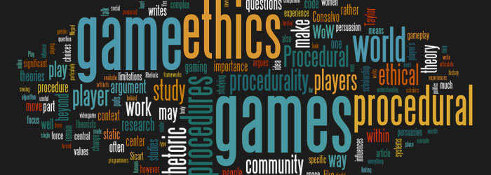

+++
title = "Book Review: Beyond Choices"
template = "mirror.html"
extra.source_url = "http://www.firstpersonscholar.com/a-review-of-miguel-sicarts-beyond-choices/"
extra.resolved_url = "https://www.firstpersonscholar.com/a-review-of-miguel-sicarts-beyond-choices/"
extra.captured = "2026-10-20"
extra.kind = "article"
extra.raw_response = "source.html.txt"
+++

> Jesse Porch is a software developer who enjoys dabbling in videogame scholarship whenever possible. He’s currently pursuing it a bit more in-depth as part of the interdisciplinary Trinity Fellows Academy, where his research focuses on the cultural role of play in ethics, empathy, and relationships.  
> 

# Introduction

It’s no stretch to say that many videogames are viewed as an avenue for posing ethical questions to modern players. “Morality points” and “moral choices” are well-publicized features of various types of games, such as the Renegade/Paragon bar in Bioware’s *Mass Effect* RPGs or *Dishonored*’s (Arkane Studios, 2012) options to deal with major targets via murder or various sinister yet non-lethal responses. Yet as the title of Miguel Sicart’s book *Beyond Choices* suggests, perhaps merely focusing on presenting choices fails to reach games’ true potential for raising ethical questions in an interactive medium. His book instead urges players, developers, and academics alike to embrace not just the possibility that games can address deep ethical questions, but to explore the ways that the medium is especially well suited to do so.

In fact, Sicart unequivocally states his aspiration “for games to have the same cultural and aesthetic impact that some North American mainstream films [such as *The Godfather*, *Apocalypse Now*, and *Taxi Driver*] had in the late 1970s” (7). It’s important to note here that he refers to mainstream films, not arthouse cinema; Sicart’s vision is nothing short of seeing his desired “ethical gameplay” present in major blockbusters as well as obscure indie projects. He speaks of a day when the “games that we play for fun” work to “transcend entertainment and claim their part in the cultural landscape as vehicles for ethical reflection” (2) through increased nuance with which ethical questions are addressed within games. A tall order, to be sure, and certainly more than can be accomplished by a single book. To his credit, though, Sicart supplements his grand vision with several observations and proposals to begin moving towards such a destination.

# Overview

The optimistic language makes it clear that Sicart intends the book as a call to readers to imagine a future where gaming intentionally addresses issues of ethical reasoning and contributes to social development of the players. He asserts that “ethical gameplay is not a gimmick or a selling point. It is a way to access one of the purposes of play that often emerges from the social and technological context of play.” (79) Core to this is a need to resist reducing games to a series of trolley problems that strip ethical dilemmas of their complexity. While such problems have their place in philosophical discourse, such idealized scenarios limit the scope of the problem so dramatically that their practical implications are much less clear. What is most beneficial is not how one responds to a specific situation, but that one has a robust ethical framework that can account for the wide variety of ethical questions that arise throughout life.

But while Sicart does think that games must move beyond choices, he’s quick to note that this does not call for the wholesale abandonment of the dilemma as a moral construct. Rather, the importance is to take full advantage of videogames’ interactive digital nature and provide better dilemmas that allow the players to practice deep moral reasoning rather than simple mathematical computation. Specifically, Sicart proposes that games avoid providing immediate numeric feedback for each decision the player makes. By directly displaying the game’s objective evaluation of the player’s actions, much of the moral reasoning Sicart seeks to encourage is trivialized. Instead of conforming to a moral structure provided by the game, he wants the player to “relate to the simulation with their own ethics, the game has to provide space for ethical agency” (80).

Another specific suggestion is to focus on “aggregation of choices” such as the faction standing in *Fallout: New Vegas* (Obsidian Studios, 2010*)* over “branching choices” favored by developers like Telltale Games. When the game system is driven by many accumulated decisions rather than individual moments that directly shift the story, the game encourages thinking in terms of ethical systems of action instead of just solving individual dilemmas (98).  Using such a system allows for the designer to make decisions dependent on context beyond the immediate circumstances, a crucial element of choices that require the player to introspectively determine goals and ethical patterns necessary to achieve them. Additionally, Sicart argues that “[t]he aggregation of choices is a better fit for designing ethical gameplay because it places the players in a narrative or world context in which many choices are offered all the time, and the consequence of each is not readily traceable to a particular choice,” (105) which more closely resembles real world ethical challenges.

To illustrate both of these ideas in action, I would like to consider *Metro 2033* (4A Games, 2010), which allows the player to choose its peaceful “good ending” only if the player has amassed a sufficient quantity of “good points” from actions throughout the game. While the game provides basic feedback for when good or bad actions have occurred, the magnitude and running tally are both hidden from the player, and nothing in the game explicitly states that such actions are being tracked or that they will influence the outcome. Perhaps more interestingly, while the actions that are tracked include such staples as saving a small child (and refusing to accept a reward), saving lives, and refusing to kill certain enemies, other things like exploring the cities, talking to their inhabitants, and finding a guitar to play are included as well. The implicit message is that making the “good” decision is not just a matter of altruism, but that even recognizing the possibility of a peaceful solution to the game’s struggle requires a person with a complex set of traits and an inquisitive outlook on life and society.

But even more important than these observations and suggestions for general design, Sicart proposes a model for thinking about the kinds of decisions that games provide a special opportunity to examine. Here he cites work on the difficulty of making moral decisions in urban planning (Rittel and Webber, 1978), borrowing Rittel and Webber’s concept of the “wicked problem.” The nature of a wicked problem is that it poses a question that defies simplistic reduction and trivialization common in many moral dilemma tropes. Among other key factors, information is limited and imperfect, the outcome of a given choice not immediately clear, decisions must be made under time constraints and without the benefit of any chance to take things back or try again if the results are unsatisfactory, all of which contribute to a complex decision without an immediately obvious right answer.

Almost all major choices we make must account for the fact that we often lack certainty about circumstance or consequence. Furthermore, any nontrivial problem is a unique collection of specific factors and constraints, the specific intersection of which is a crucial determinant of an ethical response. The framing of a wicked problem acknowledges these complexities and focuses not on the specifics of a given problem, but rather the moral thought process that goes into making a decision. Videogames have the ability to offer players a chance to face such a question and observe the results, potentially providing a foundation for a deeper insight into the patterns of thought used to answer such questions.

Sicart illustrates this with a detailed example drawn from *Fallout 3* (Bethesda Game Studios, 2008), where players are able to negotiate peaceful coexistence among the residents of Tenpenny Tower and another nearby group. This solution seems to have all the markings of a stereotypical “good” choice, and the game treats it as such. Should the player return later, however, he will discover that one of the factions has backed out of the deal and slain the other residents even after they welcomed them in to share their home (98). While grim, this clearly illustrates what Sicart considers a particularly important purpose of ethical reasoning: considering how possible outcomes may deviate from intentions and expected outcomes. That videogames can provide examples of such cases without requiring anyone suffer through the consequences makes them a useful tool in the development of robust ethical reasoning.

Wicked problems exist throughout the human experience, and there is a long tradition of wrestling with these kinds of questions through media. But *Beyond Choices* proposes that videogames provide a unique way to tackle them that is both supportive of deep introspection and accessible to the general public. For one thing, games present the question directly to the audience and ask them to make a decision themselves, rather than simply agreeing or disagreeing with the decision a character is shown to have made. And by situating all individual choices within a systemic model, games provide a way to engage the player with an overarching moral system rather than a series of isolated decisions.

# Conclusion

Above all, *Beyond Choices* is an important work well worth reading for a variety of audiences. On the one hand, it serves as a manifesto that articulates a bold vision for what videogames may one day be. Likewise, it presents a model to help imagine Sicart’s desires for ethical gameplay. On a more practical level, it proposes several specific design strategies that are already feasible and will facilitate the sort of gameplay he envisions. The numerous detailed case studies using a variety of games should be at home in a classroom setting that takes the time to examine the games in detail, yet remain accessible to anyone with a general familiarity with the medium.

However, Sicart’s dense prose does illustrate just how many complex ideas his proposals attempt to synthesize, and it is certainly fair to wonder just how effectively one could implement his vision and appeal to the mainstream audience he seems confident will eventually accept this sort of design. Indeed, one of his extended examples of a game that successfully embodies his ideals, *Spec Ops: The Line* (Yager, 2012), has received mixed reviews and has been criticized for many of the things Sicart finds praiseworthy, clearly illustrating a gap between the average consumer’s preferences and Sicart’s ultimate goal of mainstream acceptance. Anyone wanting to follow in Sicart’s footsteps would be wise to take his admonition to consider why anyone would be interested in playing their game in the first place, an important question especially in pursuit of such grand aspirations.

Still, questions of feasibility and mainstream acceptance aside, Sicart casts a powerful vision of videogames achieving something beyond mere entertainment, and even with much work left to be done he posits possible avenues to pursue that goal. With the scale of the videogame industry approaching or even surpassing that of the film industry, perhaps having a dream that videogames may one day be as revered for their moral engagement as the films he cites is not so unattainable after all.

**References**

Horst, W. J. and Melvin M. Webber (1973). Dilemmas in a General Theory of Planning. *Policy Sciences* 4. Retrieved February 1, 2016, from <<http://www.uctc.net/mwebber/Rittel+Webber+Dilemmas+General_Theory_of_Planning.pdf>>

Sicart, Miguel. (2013) *Beyond Choices: The Design of Ethical Gameplay*. MIT Press.
