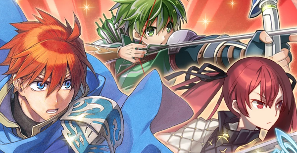
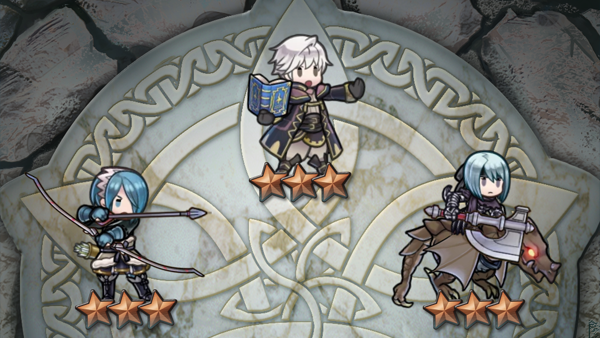
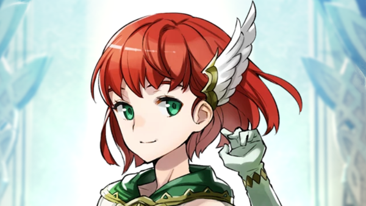

+++
title = "Playing For Real: Cheap As Free"
template = "mirror.html"
extra.source_url = "http://www.haywiremag.com/columns/playing-for-real-cheap-as-free/"
extra.resolved_url = "https://haywiremag.com/columns/playing-for-real-cheap-as-free/"
extra.captured = "2026-10-20"
extra.kind = "article"
extra.raw_response = "source.html.txt"
+++

### Jesse Porch is worth what you pay for him.

In the month and a half since it came out, I’ve spent many hours playing *Fire Emblem: Heroes*. The franchise’s first mobile iteration provides a reasonable approximation of the *Fire Emblem* experience wrapped in just enough story to tie things together. Trying the game was a no-brainer given that it packages my favorite characters from multiple games in a convenient app that I could play on my commute without having to haul around a 3DS. But the biggest selling point was the fact that it’s free. Well, technically speaking, it *can* be free, but it can also cost much more—as much as you’re willing to pay.

Anyone tangentially familiar with mobile gaming will recognize the infamous concept of “free to play,” where games are offered with no up-front price but with a variety of optional microtransactions. The amount of business development that has gone into developing and refining these strategies is mind-boggling, requiring a deep understanding of numerous acronyms, metrics, and statistical analysis methods. While exact strategies vary, the core principles have been around for quite some time: “why settle for a customer who pays once when you can find customers who will pay over and over again?”

This isn’t inherently sinister, it’s simply economics. Development costs for major games are astronomical, and they include everything from character design to market research and advertising. To recoup those costs, let alone turn a profit, often requires much more than the “sticker price” can be expected to bring in. Developers instead look for ways to amortize what costs they can, finding ways to have multiple sources of income to defray major expenses. For instance, sequels can reuse assets, design, engine resources, and even marketing as a way to amortize their cost so the developers may sustainably develop games. Downloadable content has also provided an avenue for recurring revenue, as developers can provide additional content to existing customers at a lower price to further encourage more spending.

Many games, especially in the mobile space, have continued to iterate on the DLC structure and have sharpened it to a razor-edged business model in the form of microtransactions. In order to reduce “friction,” or hesitance to make a purchase, developers provide dozens of opportunities to spend tiny amounts of money, often less than a dollar, for minor bonuses. Such purchases often fall below the threshold that most people even think about before spending. Microtransactions leverage this, along with carefully tuned pipelines that aim to “convert” many small purchases that add up to more than the game could successfully charge for a single purchase.

While mobile heavyweight *Clash of Clans* relies on small transactions for minor but reliable bonuses, “gachapon” such as *Fire Emblem* work quite differently. Named after novelty vending machines, the core hook of gacha-style games is collectibility combined with the random draw mechanic familiar to players of collectible card games. Instead of buying specific characters for their team, players can only purchase “draws” that return random characters of varying quality. While the game provides means for purchasing these draws without paying real money, the random nature of the mechanic ensures that there is always more for the player to desire, and the game is happy to provide opportunities to buy additional rolls, complete with bulk discount. Of course, even [absurd](http://www.polygon.com/2017/2/8/14546928/fire-emblem-heroes-every-character-max-barracks) amounts of money are not enough to guarantee a desired result.

As I’ve indicated above, I don’t have a problem with developers experimenting with new business models in their quest to find sustainable ways to develop the games they want to. However, the “freemium” approach is fraught with questionable moral issues, especially the gacha approach. In fact, certain especially predatory elements of the strategy have been investigated and even [banned](http://www.japantimes.co.jp/life/2012/05/16/digital/japans-social-gaming-industry-hindered-by-governments-anti-gambling-move#.WNCIRVXytQI) in Japan. But the cynical take that the “free” in free-to-play exists only as a hook to lure the susceptible in does obscure the fact many players enjoy free-to-play games without being tempted to pay anything. As I mentioned above, my decision to give *Heroes* a try was due in no small part to the lack of a barrier to entry.

While the concept of microtransactions is not inherently problematic, it’s clear that it can quickly devolve into a mess when not applied judiciously. Perhaps the greatest pitfall lies when a game developer focuses on optimizing a game’s profitability by any means. This makes the core design focus the pursuit of “whales” who will spend thousands of dollars, which means games ultimately require this hyper-investment in order to play in the fullest sense. The corollary is that because the microtransactions are designed to encourage bulk purchasing, each individual purchase has a negligible impact. This quickly degrades into a vicious cycle where rewards are sweetened to encourage more spending, and in response the game balance shifts to accommodate more players buying them to keep up.

A few weeks ago, a PAX East panel moderated by [James Portnow](http://news.digipen.edu/academics/the-many-roles-of-james-portnow/#.WNHUvlXytQI) of [Extra Credits](https://en.wikipedia.org/wiki/Extra_Credits) was asked directly what they thought was needed to “make mobile gaming less shitty.” The panel’s response centered around a need for game economics to shift focus away from getting $1000 from a single user, prioritizing finding reliable ways to get $2.00 from 500 instead. Portnow clarified that he didn’t think this required removing the ability for “whales” to spend such significant amounts, but that getting past accepting that model as the assumption would permit experimentation to find healthier models that made for better games. This is great in principle, but of course the actual implementation requires finesse. If, as the industry seems convinced, the optimal monetization method really is focusing on the few deepest pockets, then even with good intentions the path of least resistance will just lead things back to whale hunting.

To further complicate things, this rubric, like the other myriad measurements inherent in the “free” pricing structures, can end up competing with the goal of producing games that people enjoy and want to pay for. In the social sciences, Goodhart’s Law is the observation that as soon as a measure becomes a target, it loses much of what made it a valuable measure in the first place, so optimizing for it can actually work against the intended goal. For instance, while it makes sense that good games are likely to have long average playtime, but when you make “long playtime” the goal of your development as a means to have a “good game,” you are just as likely to pad out your game with unwanted busywork that alienates players instead of attracting them.

It’s much easier to discuss a game in the context of its revenue, including models of anticipated future earnings, than it is to describe what players specifically value in the game. Which makes sense, because value is a subjective experience and metrics deal in objective and quantifiable reality by definition. I’ve written before on how even well-intentioned attempts to measure a game’s value, such as “hours of gameplay per dollar,” can themselves drive [commodification](https://haywiremag.com/columns/playing-for-real-the-content-factory/) of the medium and work against the artistic elements also present. This is what makes having a reasonable, non-exploitative “free-to-play” model such a difficult task: by nature, microtransactions require micromanagement to remain functional.

All told, the “free-to-play” or “[games-as-a-service](http://www.gamasutra.com/blogs/SethSivak/20130305/187766/The_Future_of_Games_as_a_Service.php)” model has plenty of potential to provide new and interesting experiences for players. Examples from both the mobile space and traditional gaming, while flawed, would simply not exist without business models that can fund their continued development. This becomes problematic when the means veer into exploitation, such as encouraging unhealthy impulses through calculated psychological manipulation. Common tricks, such as random prizes that are displayed to seem like a [close call](https://www.youtube.com/watch?v=ebhPPgs1p-E&t=67), are lifted directly from gambling, and serve the same purpose in videogames.

Despite these flaws, the fact remains that the reduction in friction, especially through the removal of large up-front costs, does increase game accessibility. Experiments such as Nintendo’s *Super Mario Run* have found success attempting to straddle the line between premium “buy once” and free-to-play titles, while Valve’s *DotA 2* provides millions of players with free access while being supported by a thriving exchange of cosmetic skins. Games like this and Supercell’s *Clash of Clans* leverage the networking effect that comes from having a massive pool of free players, essentially allowing those who desire to “pay to win” to subsidize a nearly equivalent experience for the millions who are content to play the game without any investment.

Ultimately, while I find much of *Fire Emblem: Heroes*’ design frustrating, what bothers me the most is that I see little point in supporting it through purchase. There’s no value in spending a few dollars, especially with no ability to spend it towards anything in particular—not that I’m bitter about Hector and Takumi playing hard to get or anything. Nintendo’s many recent successes at entering the mobile game space have buoyed their confidence in adopting modern mobile business practices, and the prospect of having beloved franchises continue to expand into the market is certainly appealing. Hopefully they will manage to do so in a way that maintains their core appeal without falling prey to the promise of easy profitability as just another producer of freemium mediocrity. Because while there is certainly such a thing as a free game, the question is always whether or not it’s worth the cost.

---

*Jesse Porch is a software developer who enjoys dabbling in videogame scholarship, especially the cultural role of play in ethics, empathy, and relationships. Check out his other work* [*here*](http://www.jmporch.com/)*.*
