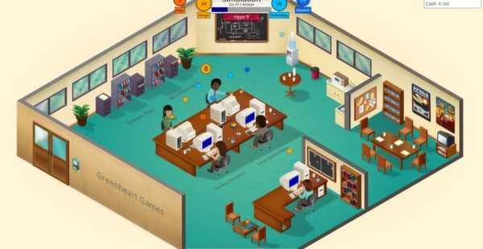
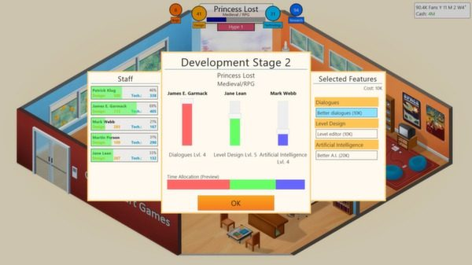
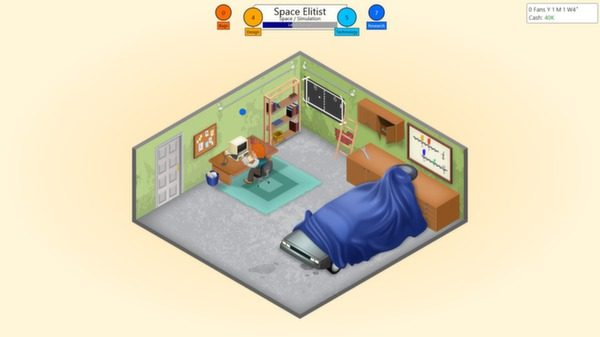
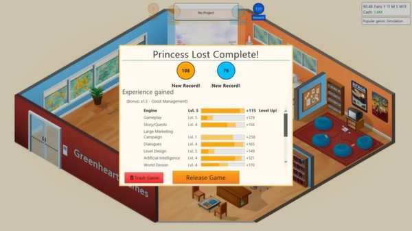

+++
title = "Playing For Real: The Content Factory"
template = "mirror.html"
extra.source_url = "http://www.haywiremag.com/columns/playing-for-real-the-content-factory/"
extra.resolved_url = "https://haywiremag.com/columns/playing-for-real-the-content-factory/"
extra.captured = "2026-10-20"
extra.kind = "article"
extra.raw_response = "source.html.txt"
+++

### Jesse Porch is just another cog in the machine.

When discussing videogames, one topic that’s sure to come up eventually is working conditions in the industry. From [EA\_Spouse’s whistleblowing](http://ea-spouse.livejournal.com/274.html) over a decade ago to more recent horror stories such as [the collapse of Kaos Studios](http://www.polygon.com/2012/11/1/3560318/homefront-kaos-studios-thq) in the wake of its project *Homefront*, life as a game developer has never been easy or particularly secure. While less visible in the indie scene, the high profile discussion of [self-imposed crunch behind the successful solo project *Stardew Valley*](http://www.gamasutra.com/view/news/267563/The_4_years_of_selfimposed_crunch_that_went_into_Stardew_Valley.php) indicates that the issue of crunch runs much deeper that just a failure of corporate planning and resource allocation.

The topic arose again a few weeks ago, with [Alex St. John’s now-infamous article on VentureBeat](http://venturebeat.com/2016/04/16/game-developers-must-avoid-the-wage-slave-attitude/) accusing game developers pushing back against typical industry conditions of suffering from a “wage-slave” mentality, saying you shouldn’t “be in the game industry if you can’t love all 80 hours/week of it — you’re taking a job from somebody who would really value it.” Indie developer Rami Ismail, half of the independent game studio [Vlambeer](http://www.vlambeer.com/), was quick and forceful in his [response](http://ramiismail.com/2016/04/an-inline-response-to-wage-slaves/): “structural crunch is a horrible attitude and can really damage someone’s ability to function and enjoy their dream job.” That this remains a widespread and recurring issue is certainly a major puzzle for the industry, but it stems from a far more troubling way of thinking about games themselves, an issue that affects all levels of the industry as well as consumers and press.

In a conversation with Ismail at PAX East, we discussed the nature of the game industry’s relationship with crunch. To be clear, his frustration is not simply that crunch exists, but that the industry is “dependent on it.” In his view, crunch seems more cultural than economic: a willingness and capability to work long hours is viewed as a mark of honor among one’s peers and a sign of devotion by one’s superiors. While economic pressure exists, such as maintaining existing price-points, the culture that accepts crunch as a means to answer those concerns is the greater problem.

Key to understanding this disconnect is Ismail’s argument that St. John’s article “conflates two things: being an entrepreneur, and being an employee.” St. John claims that his article is meant to be empowering, encouraging the exploited “wage slaves” to throw off their shackles and be their own bosses, shouldering the risk and the reward of game-making. Even if it’s not always practical for an established developer with family and social obligations, this approach has some merit, and as we’ve already mentioned in regards to *Stardew Valley*, can turn out well.

However, as Alex’s [other work](http://www.alexstjohn.com/WP/download/Recruiting%20Giants.pdf) makes clear, his actual point is much less encouraging, and in between horrible comments about employees with disabilities he shows very little regard for employees in general. With advice to managers advocating things like “Churn and burn to find an ‘optimal’ team”, St. John views employees as disposable tools, his strategies focused not on enabling developers to do great work but on finding those that are willing to provide the most labor at the cheapest cost. There are practical concerns about the sustainability of any system built on intentional burnout, but it reveals a deeper philosophical problem: the commodification of the videogame.

Before delving into this process in detail, let us first consider a bit of context. ”Commodity” is an economic term for the most basic resources, such as produce or minerals. Commodities are considered “fungible”: one pound of coal works just as well as any other pound for a given use. As an economy develops, the majority of trade shifts from commodities to “goods,” which are more complex and begin to be distinguishable. While two chairs serve the same general purpose, they’re made differently enough that you could have reason to prefer one specific chair to another. Modern economies focus primarily on “services”: rather than selling a product to accomplish a given task, they sell the time and expertise of people who can fulfill that task on the consumer’s behalf. However, as Joseph Pine and James Gilmore argue in their treatise *The Experience Economy*, even thinking in terms of services misunderstands the economic realities of the developed world.

As their title implies, Pine and Gilmore see the successor to the service economy to be the production and consumption of experiences, valuing the memory associated with a transaction rather than the outcome of the transaction itself. This fits directly within a [model of playfulness](https://haywiremag.com/columns/playing-for-real-let-there-be-play/) that focuses on the meaning inherent in the process rather than focusing only on the utilitarian outcome of a given act. “Organizations that have a service mindset focus solely on ***what*** tasks employees do; those with an experience mindset also consider ***how*** those tasks are performed…” (emphasis original). This is closely related to the idea behind “gamification,” which aims to use game mechanics to structure an otherwise mundane process and make it more compelling. Experiential design has the potential to open new avenues of providing value to the consumer by thinking in broader terms about what specifically they are consuming.

While Pine and Gilmore apply this principle across virtually all industries, our specific area of interest is videogames. Given their playful nature, the vast majority of games are perfect candidates for experiential thinking: tremendous amounts of time and energy are put into every facet of the *how* the content is delivered. Game design builds certain experiential elements into a videogame that serve as a fundamental component of the work. The craft of the designer is to construct a system that communicates through process, rather than just about process, and engaging in these processes requires some baseline of “experience”. This doesn’t restrict games to existing only within “the experience economy”, but we should acknowledge that they naturally lean in that direction.

Interestingly, we often end up discussing videogames using language more typical of a commodity than an experience. While the natural economic progression is to move from commodities toward increasingly complex products, “commodification” describes the opposite trajectory: reaching a point where products become homogenized and begin to behave interchangeably once more. This is not a bad thing: the commodification of GPS technology has changed the roadtrip, and the sort of  journeys we now casually undertake once required someone with deep and detailed knowledge of the route and destination. In fact, the commodity actually provides major advantages over the tour guide by being able to connect with a broader body of real time information and provide additional features, such as routing around traffic. Commodification is not a negative transformation, but it is crucial that we understand how it changes both a product and how we relate to that product.

In the case of videogames, this phenomenon has several important effects. Ismail observes that “we want to think of games like art but we want to treat them like commodities. And that’s true for the developers and the consumers.” The problem here is that treating games like commodities undermines the depth of the experience they’re designed to convey. A game-as-commodity is about providing a chunk of generic entertainment-hours, not the sort of experience each specific game is able to provide. In these terms, the amount of gameplay a game can provide would be the primary consideration for a consumer.

But at a higher level, if a game is indistinguishable from its alternatives, we find an interesting corollary: as the buyer prioritizes hours of gameplay per dollar spent, those making the games will have incentive to maximize that ratio while minimizing budget. Given how much of a typical budget goes to labor, this means getting more work from the smallest team possible. The same mindset that undermines the experiential qualities of the game encourages an employer to view (and treat) employees themselves as interchangeable tools. While not as openly misanthropic as Alex St. John’s work, there remains a strong connection between viewing games as a commodity and an economic pressure to view game developers as a commodity.

What makes this dangerous is that many talk about games in artistic terms while simultaneously acting within the mass produced commodity mindset, which leads to two major disconnects. One, the industry is especially susceptible to the language of passion and pride in one’s craft. If developers believe their efforts to be contributing to a unique experience, they may be more willing to push through undesirable working conditions than if the perceived result is another generic lump of entertainment hours. An employer has incentive to encourage their employees to view the outcome as art while continuing to schedule the production process as if it were a factory floor.

The other end of the issue is on the marketing side: the price model for commodities has always led to a race-to-the-bottom mentality, as many fear today’s “bundle-pocalypse” and Steam sales are doing. Because any product is interchangeable with any other, getting the lowest price and the most public listing are the only ways to maximize units sold. This phenomenon is not unique to the game industry, and Gilmore and Pine consider it a widespread problem: “While customers love a sale, businesses perish from relying on low prices as a means of hawking their offerings…in industry after industry, that system of competition no longer sustains growth and profitability.”

Promoting this sort of commodifying arms race devalues games and undermines the industry that creates them. It becomes a self-fulfilling prophecy: if customers expect games to be commodities, each bundle of gameplay merely a new morsel of content to consume, then the mindset will necessarily bubble up on both economic and cultural fronts. Which seems to be what we’ve seen in practice: even those who passionately desire to produce games that aren’t interchangeable commodities must work within an industry that functions as if that’s all that games are.

Consider *Firewatch*, which received many accolades but was often criticized for being too short for its price. Jane Ng’s [response](http://www.kotaku.com.au/2016/02/firewatch-developer-offers-classy-response-to-steam-refund-request/) to such criticism illustrates just how important consumer mentality is to combating a monolithic drive towards commodification. Metrics like hours-per-dollar have their place in making informed decisions about which games to purchase. But putting too much weight on any single rubric has its pitfalls, too. The accessibility of game engines and the rise of digital distribution channels have opened new doors economically and artistically, and the industry is a better place for both creators and consumers, but this commodification is not without cost. The way we think about videogames themselves impacts the medium and everyone involved with it.

[*Ed. note:* *The images in this article are screenshots from Game Dev Tycoon.*]

---

*Jesse Porch is a software developer who enjoys dabbling in videogame scholarship, especially the cultural role of play in ethics, empathy, and relationships. Check out his other work* [*here*](http://www.jmporch.com/)*.*
