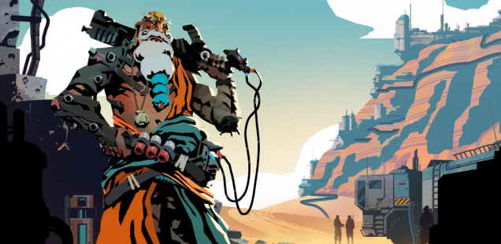
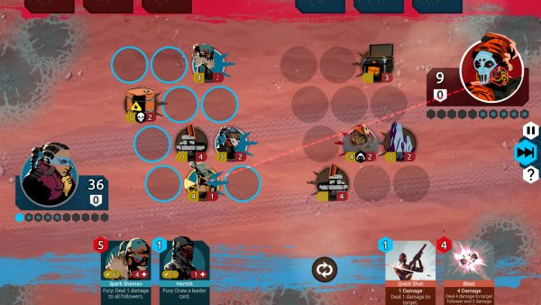

+++
title = "Playing For Real: Decks to Dust"
template = "mirror.html"
extra.source_url = "http://www.haywiremag.com/columns/playing-for-real-decks-to-dust/"
extra.resolved_url = "https://haywiremag.com/columns/playing-for-real-decks-to-dust/"
extra.captured = "2026-10-20"
extra.kind = "article"
extra.raw_response = "source.html.txt"
+++

### Jesse Porch faces injury and loss in Nowhere Prophet.

Collectible card games (CCGs) are a bit of a cliché these days; scarcely any IP seems safe from being melted down and cast into yet another *Magic: The Gathering* clone. The trend has only intensified with the jump to digital formats, which have a much lower barrier to entry than paper-based games with their need to manage physical production and the other logistics of distribution. It’s easy to write all of them off as blatant cash-grabs that force players to repeatedly spend money to fill collections routinely phased into obsolesce. But because [*Nowhere Prophet*](http://www.noprophet.com/), by Sharkbomb Studios, aims to buck the trend and avoid the “collectible arms race” it manages to stand out both through its take on the genre’s conventions and its stylish Indian-inspired post-apocalyptic aesthetic. *Nowhere Prophet* is far more than just a fresh coat of paint—in true Mad Max fashion it has broken its inspirations down to scrap and welded assorted genre conventions onto a different chassis altogether.

Rather than simply adopting the CCG conceit of a central pool of cards which are always available and pitting you against opponents with the same available tools (conveniently encouraging you to reach for your wallet to fill out your collection and be on an even playing field), *Nowhere Prophet* frames itself as a “roguelike deckbuilder,” starting with a basic deck that is gradually modified through random additions and subtractions over the course of a single-player campaign. Victory—or, much more likely, defeat—ends the run and the next attempt will reset the player’s deck to this same starting point. This substitution of a transient pool of cards in place of a persistently growing hoard both ties matches within a campaign together far more tightly than isolated CCG bouts and allows for a clean reset every once in a while. By resetting the state after each campaign, the game keeps the replayability of constantly chasing after more cards for your deck without needing a steady infusion of completely new cards into the game, a practice which is common in the CCG space as it provides a constant wave of planned obsolescence for old cards as it provides new ones for them to chase.

Interestingly, however, *Nowhere Prophet* takes things further with a clever twist: cards that are defeated in one match do not return pristine for use in the next one—after its first “death” a card becomes “wounded,” decreasing its effectiveness in subsequent matches. Further, any wounded card that is defeated again is destroyed permanently. The concept of treating cards as disposable elements has occasionally been tried in physical games, notably the growing trend of “Legacy” style games. Players of such games must routinely rip up cards as they use them, apply stickers to change their printed instructions, and find and add new cards to the play area to dynamically impact the course of the game. Digital games can implement such actions with virtually no friction at all—seamlessly allowing cards to change state repeatedly before being potentially destroyed forever—giving a liveliness that counters the commodification of a player’s “units” so common in strategy games. While many tactical roleplaying games rely on customization, complex stats, and unique pictures to give characters a sense of personality, *Nowhere Prophet* manages it with little more than a random name and the individual prospect of loss.

To add to the emotional weight, cards are called “Followers” in an explicitly religious sense, with your avatar being a “Prophet” tasked with leading them on a pilgrimage. This narrative framing stands in stark contrast to the mood evoked by Heathstone’s use of the terms “Hero” and “Minions” to fill mechanically analogous roles. While the Prophet is still clearly the “hero” of the adventure, the attitude towards the followers is completely different. Instead of being little more than the disposable pawns needed to secure your victory, they are both a scarce resource your use to cross the desert and people you’re trying to convey safely to your destination.

This change alone is not mere flavor, and dramatically alters the experience. Most CCGs involve a binary ending: either you fulfill one of the possible victory conditions and win the match or your opponent does. Since each game has no impact on those that follow, play tends to treat cards as purely disposable. Sacrificing a card for a minor advantage is not only viable, it’s often the correct play in a given scenario, much like how chess masters freely expose valuable pieces as long as they can capture an even more valuable one from their opponent in exchange. Instead, each match is now one engagement in a war of attrition, and without care a safe victory can turn Pyrrhic with barely any warning. This crucial difference gives *Nowhere Prophet* its unique voice, despite otherwise familiar moment-to-moment gameplay.

In a wasteland full of generic CCGs that are little more than excuses to keep selling “packs” of random cards, *Nowhere Prophet* stands out for its bold vision. By embracing the implied physicality of the cards within its basic mechanics, the game presents a far different mood than typically found in digital card games. The use of roguelike elements powerfully complements the transience of individual cards, supporting the game’s narrative of a leader cobbling together a following out of anyone they can find willing to join their pilgrimage. This ultimately requires balance between treating them as tools to aid your quest and charges you are responsible to shepherd to safety, subverting the pure disposability often present in roguelikes. *Nowhere Prophet* stands as an excellent example of aligning aesthetic, narrative, and mechanics such that the whole is most certainly great than the sum of its parts.

---

*Jesse Porch is a software developer who enjoys dabbling in videogame scholarship, especially the cultural role of play in ethics, empathy, and relationships. You can find some of his stuff on Haywire, and check out his other work [here](http://www.jmporch.com/).*
