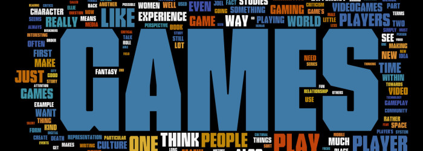

+++
title = "Free to be Useless"
template = "mirror.html"
extra.source_url = "http://www.firstpersonscholar.com/free-to-be-useless/"
extra.resolved_url = "https://www.firstpersonscholar.com/free-to-be-useless/"
extra.captured = "2026-10-20"
extra.kind = "article"
extra.raw_response = "source.html.txt"
+++

> Jesse Porch is a software developer who enjoys dabbling in videogame scholarship whenever possible. He’s currently pursuing it a bit more in-depth as part of the interdisciplinary Trinity Fellows Academy, where his research focuses on the cultural role of play in ethics, empathy, and relationships.  
> 

It was a huge encouragement to read [Luca Morini’s wonderful article](http://www.firstpersonscholar.com/play-as-bulwark-of-uselessness/) on play as the “bulwark of uselessness” on May 4th. Having a deep understanding of and appreciation for play is a crucial part of human culture and society, and as Luca notes the freedom to be playful–to enjoy things for their own sake–is often sacrificed on the altar of “usefulness”, leading not to the enhancement of human culture but to its diminishment. To echo Luca’s use of Huizinga: “The very existence of play continually confirms the supra-logical nature of the human situation…**We play and know that we play, so we must be more than merely rational beings**, **because play is irrational**.” (emphasis added)

This quality of play, a willingness to revel in the process rather than the accomplishment, is certainly worth preserving. I wholeheartedly agree with Luca’s attempt to reconcile the positive goals of “gamification” with this impulse to preserve play’s defining sense of freedom and spontaneity. The danger of what he calls “false playfulness” is all too real, and wrapping mundane but “useful” tasks in the guise of “useless” but enjoyable play walks a dangerous line that risks undermining both the utilitarian objective and poisoning the wellspring which playfulness alone can tap.

However, in the interest of rounding out the conversation, I wish to offer a few observations and try to refine the language a bit. While I find the image of the “bulwark of uselessness” quite delightful, especially with a similar affinity to playing the tank, I wonder if embracing the term “useless” might be doing more harm than good. As Miguel Sicart specifically notes, at its core, “play is a manifestation of humanity, **used for expressing and being in the world**,”(emphasis added). While I’m fully on board with the notion that not everything need be subject to the tyranny of utility, I think that conflating “useful” and “utilitarian” actually cedes more ground than necessary.

I find it more useful to avoid focusing on “useful” and instead speaking in terms of “meaning” and “purpose”. Play is distinguished by a certain aimlessness or lack of utilitarian intention(purpose), but this does not undermine its ability to be significant and valuable(meaningful). In this purposeless meaning–the “supra-logical nature” that Huizinga described–we are able to see play not as useless, but useful for something deeper to our being than mere utility. Renowned artist Makoto Fujimora [tells a poignant story](http://fujimurainstitute.org/wp-content/uploads/2014/03/FI-CultureCareAbrev.pdf) from his “starving artist” phase when he once got angry at his wife for spending money on flowers while the refrigerator sat empty. The flowers were clearly “useless” in a strictly utilitarian sense, but as his wife corrected him “We need to feed our souls, too.” The artist admits to being humbled by the fact that even as someone who aspired to make his living providing meaningful but non-utilitarian works he was still susceptible to the same reductionism often used to denigrate the value of the arts.

Although much of society’s progress is owed to science and reason, it is a mistake to think that such can fully quantify the depth and beauty of the human condition, and many significant epochs of human civilization preceded Bacon and the scientific method. Huizinga notes that play is irrational,  but he concludes that as *homo ludens* we are “above logical” precisely because we can understand play’s purposelessness and still continue to pursue it intentionally. Play is deeply meaningful to us, not because of what it accomplishes, but for its own sake. And in that way, it is very useful, even when it does sometimes lack purpose.

Brian Sutton-Smith reaches a similar conclusion in *The Ambiguity of Play*: “One can say of both religion and play that they make life worth living and make everyday activities meaningful, because of the transcendence that they propose, one eternal and one mundane.” Thus I’d like to augment Simon’s “bulwark of uselessness” with the idea of play as a source of “mundane transcendence” that is, in fact, quite useful to our species, though perhaps not in any ways that we’re used to considering. To stick with Sutton-Smith’s analysis: “Believers are willing to acknowledge that religion has made their lives meaningful, but players are hesitant to say the same of their games…**This confines play to a secondary epistemological status…this downgrading of play is a habit of Western self-conception rather than a necessary truth.**” (emphasis added)

By focusing not on “usefulness” but on meaning we are free to consider new ways of being useful. And this is the essence of play: to value actions not for what they accomplish, but for how they are undertaken in the first place. The challenge this poses is to find a way to strike a balance between valuing things for their utility while still allowing room for significance apart from strict purpose. Sutton-Smith further notes that “Huizinga’s position is that there is morphological parallelism between playful contests and the actual contestive conduct of politics, the law, scholarship, and the arts.” Thus even playful activities divorced entirely from the productive endeavors “are the forms through which civilization rises and develops. As time passes, [Huizinga] says, they are unfortunately smothered and lost, becoming  not civilization’s foundation but merely secondary, as play.”

None of this implies that acts of play are themselves somehow magical. Rather, quite the opposite: the freedom from being justified only–or at least primarily–through their utilitarian purpose allows us to take such actions as only seriously as we desire. The point is not that pure play is superior to utility, but that it provides a necessary counter-balance to a life based upon the pursuit of utility alone. Romano Guardini, a noted scholar, observed that “When life lacks the austere guidance of the sense of purpose it degenerates into pseudo-aestheticism. But when it is forced into the rigid framework that is the purely purposeful conception of the world, it droops and perishes.” More poetically, he described play as “life, pouring itself forth without aim, seizing upon riches from its own abundant store, significant through the fact of its existence.”

Interestingly, Guardini was not speaking as a play theorist at all, but in his role as a Roman Catholic theologian. Despite his commitment to taking his faith seriously, he did not hesitate to identify play as a core element of its practices and rituals. Faithful adherence to the liturgy was “beautiful, too, if it is left to itself, and **if no futile advice and pedagogic attempts at enlightenment foist upon it a host of aims and purposes, thus denaturizing it.**”(emphasis added) Guardini was himself a critic of the “utilification” of the liturgy, seeking to commandeer an inherently meaningful action for the sake  of making it primarily about propose. Ironically, Guardini noted that liturgy did convey a message: “that of teaching the soul not to see purposes everywhere, not to be too conscious of the end it wishes to attain, nor to be desirous of being over-clever and grown-up, but to understand simplicity in life.”

My point in this whole digression is simple: I absolutely agree that play is important to humanity despite the fact that it may also be “useless” in a utilitarian sense. But I want to make sure that we don’t confuse the fact that play may be pointless and remain meaningful with the claim that play is meaningful because it is useless. As Luca discusses, properly understood there is tremendous potential for gamification to affect positive change in our world. But it must be done while respecting play as inherently meaningful, not as the source of that meaning.

But at a deeper level, by accepting that play is meaningful for its own sake rather than being justified through its purpose, we find that it frees play to be useful in ways we could never have imagined under a purely utilitarian paradigm. On this front, I could never hope to say it better than J.R.R Tolkien did, so I’ll end with his thoughts on fairy tales:

“If adults are to read fairy-stories as a natural branch of literature…what are the values and functions of this kind?…First of all: if written with art, the prime value of fairy -stories will simply be that value which, as literature, they share with other literary forms. **But fairy-stories offer also, in a peculiar degree or mode, these things: Fantasy, Recovery, Escape, Consolation, all things of which children have, as a rule, less need than older people. Most of them are nowadays very commonly considered to be bad for anybody.**” (emphasis added)

*Author’s note: This article is based upon my earlier work originally published in* [*Haywire Magazine*](http://www.haywiremag.com/columns/playing-for-real-let-there-be-play/)*. Special thanks to Josh Trevett and Dakoda Barker for their assistance with it.*

**Works Cited**

Guardini, Romano. *The Spirit of the Liturgy*. Veritatis Splendor Publications, 2012.

Huizinga, Johan. *Homo Ludens: A Study of the Play-Element In Culture*. Martino Publishing, 2014.

Sicart, Miguel. *Play Matters*. Cambridge, MA: MIT Press, 2014.

Sutton-Smith, Brian. *The Ambiguity of Play*. Cambridge, MA: Harvard University Press, 1997.

Tolkien, J.R.R. “On Fairy Story.” *The Monster and the Critics and Other Essays*. London: HarperCollinsPublishers, 2006.
