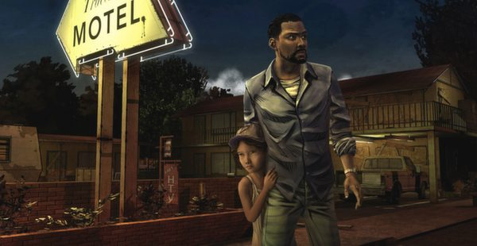
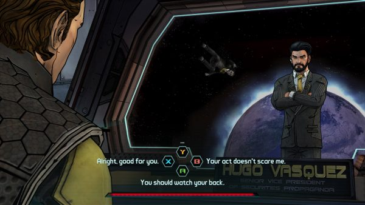
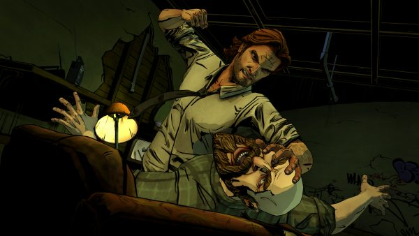

+++
title = "Playing For Real: Freedom of Choice"
template = "mirror.html"
extra.source_url = "http://www.haywiremag.com/columns/playing-for-real-freedom-of-choice/"
extra.resolved_url = "https://haywiremag.com/columns/playing-for-real-freedom-of-choice/"
extra.captured = "2026-10-20"
extra.kind = "article"
extra.raw_response = "source.html.txt"
+++

### Jesse Porch already knows how the story ends.

Telltale Games is best known for their modern take on the *Choose Your Own Adventure-*style storytelling, inspired by a series of books published in the ‘80s and ‘90s. Eschewing the morality bars and faction standings that are staples of contemporary role-playing games, Telltale opts to directly reimplement the branching narrative model that the books were known for. The resulting games faithfully recreate the experience but leverage computer technology to work around some of the most frustrating elements, notably the infamous “turn to page 43 to bargain or page 67 to fight” instructions that broke up the story’s flow and made it easy to lose your place.

As Telltale’s cofounder Kevin Bruner mentioned at a [PAX East keynote](https://www.twitch.tv/videos/41092970) a few years ago, the resemblance to this classic form of interactive storytelling is not coincidental: it’s part of the creative DNA that inspired Telltale’s founders to strike out on their own and develop games to tell their own stories. Kevin describes Telltale’s style of story-games as heir not just to the specific sort of interactive narrative present in the *CYOA* books, but as part of a lineage of interactivity that includes parser-based text adventures, *Dungeons and Dragons*, and even the classic oral traditions that modern culture is built upon. At first blush, classical storytelling may seem passive compared to the other kinds of stories that are obviously participatory. Isn’t interactivity in storytelling something that videogames helped to bring about?

Kevin tackles this seeming contradiction with an easy-to-miss line that’s worth examining in detail: “Stories are toys, these curiosities that you can play with.” He frames that not as an innovation ushered in by the rise of the morality bar, the dialog tree, or even the humble “turn the page to…” instructions printed in a physical book, but as a fundamental element of story that has been with us since our ancestors first gathered around the campfire to pass their tales to the next generation. Neither Telltale’s games nor the works that inspired them—digital or analog—were responsible for grafting interactivity onto a static medium; each serves as a new means of incorporating the interactivity that had been a part of storytelling all along.

Examples of interactive storytelling can be traced back throughout all of recorded history. For instance, the Jewish ritual of Pesach (Passover), has been practiced throughout the world for millennia. A primary focus of the week-long celebration is a [carefully planned meal](http://www.chabad.org/holidays/passover/pesach_cdo/aid/1751/jewish/What-Is-a-Seder.htm) known as the Seder (literally: “order, arrangement”) whose traditional elements each symbolize part of the story of the Exodus, a crucial moment of shared Jewish heritage. At the climax of the meal, a child is prompted to ask a short series of questions beginning with “why is this night different from all other nights,” and the elders then share the story the celebration is designed to evoke. Likewise, the Christian rite of the Eucharist (Communion), which derives from the same meal, adapts the core elements of unleavened bread and wine as reminders of Christ’s body, blood, and crucifixion, regularly performing the ritual to fulfill Christ’s instruction to “do this in remembrance of me”. Both religious rituals embrace their medium, a shared meal, for the purpose of involving a community in the story central to their heritage. These kinds of celebrations are participatory and interactive in deep and powerful ways and have been so since before videogames, computers, or even books existed; clearly interactive narrative exists well beyond the confines of the digital artifacts that litter our Steam libraries.

If interactive storytelling is not some new development uniquely enabled by modern printing and computer technology, but instead part of the narrative family tree throughout the ages, then it seems videogames must have *some* sort of overlap with these more traditional forms of such tales. Clearly games can do things that are difficult or impossible in physical media, such as obviating the burden of flipping pages, and tracking hundreds of decision points at once without being overwhelmed. But we can’t become so enamored with these tools that we reduce our understanding of either interactivity or narrative to compensate.

For instance, a major complaint about Telltale’s particular brand of game story is that your “[choices don’t matter](http://www.gameinformer.com/b/features/archive/2015/02/03/why-your-choices-dont-matter-in-telltale-games.aspx).” To an extent, this is true; most decisions the player can make have little if any impact on even the minor plot arcs, and often a second playthrough reveals that the outcome was predetermined and the choice simply resulted in slightly different dialog accompanying it. In many ways, Telltale has managed to reduce the plot impact of player choices beyond their direct inspiration in *Choose Your Own Adventure* stories. But in doing so, can we really say they’ve made their stories less interactive?

Consider the earlier example of Communion and Passover, two undeniably interactive examples of storytelling aimed not at allowing the audience to guide the narrative, but as a means of preserving it and allowing them to experience it as their predecessors had. Telltale’s writing may not always allow players to shape the outcome of their games, but by limiting our thinking of interactive story to only instances where we decide what happens we dismiss many avenues of engagement.

Telltale’s claim that “the story is tailored by how you play” is frequently accused of being false advertising because of the deceptively fixed nature of the stories told in games like *The Walking Dead;* but even if the narrative arc is largely fixed, the game’s subtle changes do shape the player’s experience of the story. Lee’s mission to protect Clementine is made more compelling by the tragic and inescapable fate that awaits him. My choices while playing his story do matter, not because they change the outcome, but because they allow me shape how I experience the immutable events for which Lee is destined. Lee’s doomed quest feels far more heroic than the deluge of stories where the [character is fated to survive against the odds](https://haywiremag.com/columns/playing-for-real-holding-out-for-a-hero/), and the reality of struggling without knowing which, if any, of his actions will mean something in the end better connects Lee’s story to our own. Some of our most important stories are of how protagonists faced their fates, not how they charted their own course.

Long before the most recent bout of the “story versus gameplay” conflict erupted, Chris Franklin of *Errant Signal* did an excellent episode on the [Ludology versus Narratology “debate”](https://www.youtube.com/watch?v=xBN3R0m31bA) that makes the imminently sensible observation that both games-as-systems and games-as-story are useful tools for analyzing specific subsets of the medium, and that game development as a discipline is impoverished when we lean too far to one side and apply it as a universal requirement of games. In a similar manner, I propose that the same can be said of agency versus structure in games: neither is itself the proper way to incorporate interactivity into game storytelling.

The belief that only limitless agency, either of the player or the protagonist, is the ultimate end of interactivity misunderstands the impact that structure and constraint can have in shaping effective storytelling. Just as strictly defined religious ritual has served as one of the primary means not only of communicating traditional knowledge, but of including generation after generation into shared social spaces, so can the careful use of rules and restrictions in games enhance our engagement with the story being told. Miguel Sicart, in his book *Play Matters*, writes that “play is a manifestation of humanity, used for expressing and being in the world.” In that sense, it’s the decisions we make that serve no purpose that allow us to express our most honest selves. Choices that change nothing are not meaningless choices, they may simply be “[significant in the fact of their own existence](https://haywiremag.com/columns/playing-for-real-let-there-be-play/).”

---

*Jesse Porch is a software developer who enjoys dabbling in videogame scholarship, especially the cultural role of play in ethics, empathy, and relationships. Check out his other work* [*here*](http://www.jmporch.com/)*.*
