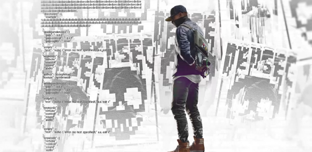

+++
title = "Playing For Real: Hashtag the World"
template = "mirror.html"
extra.source_url = "http://www.haywiremag.com/columns/playing-for-real-hashtag-the-world/"
extra.resolved_url = "https://haywiremag.com/columns/playing-for-real-hashtag-the-world/"
extra.captured = "2026-10-20"
extra.kind = "article"
extra.raw_response = "source.html.txt"
+++

### Jesse Porch really just wants your retweets.

*Watch Dogs 2* goes to great effort to feel “almost real.” From the [painstakingly modeled San Francisco landmarks](https://www.cnet.com/news/watch-dogs-2-screenshots-vs-san-francisco-real-life-pictures/) scattered across the map to clear stand-ins for major tech companies based in the region, the setting is designed to present a plausible alternate reality. With its “ripped from the headlines” references abounding—one of the earliest quests involves a pharmaceutical profiteer attempting to purchase exclusive rights to a [forthcoming hip-hop album](https://www.bloomberg.com/features/2015-martin-shkreli-wu-tang-clan-album/)—*Watch Dogs 2* seems like it’s putting together pieces to address cutting-edge concerns of modern society.

It’s not merely the people and places that uncannily mirror our own reality; the game’s entire aesthetic draws heavily from modern internet culture. In-game abilities are presented as apps on the protagonist’s phone, and major plot points involve tech startups, social media, and hot-button issues such as data-mining and privacy concerns. The player’s “level” is tied not to abstract experience points, but to their social media follower count. Bonus activities are available to boost this number, and involve everything from app-assisted driver-for-hire missions to taking selfies inside Alcatraz.

More sinister resemblances involve reference to major social issues like voter manipulation, propaganda, corporate capture of regulatory bodies, and police brutality. These timely elements allow the game to weigh in on many high-profile issues. At a high level, *Watch Dogs 2* seems incredibly progressive, tackling dozens of cutting-edge social ills as it builds the hackers of “DedSec” up into a mythologized band of virtual freedom-fighters fighting back against institutional prejudice and oppression. But in trying so hard to channel a modern sensibility and relevance, the game also makes its greatest mistake: embodying the the worst qualities of the social media centric worldview its vision is built upon, ceding most of its moral foundation. The game may be about many pertinent issues, but ultimately it has little of substance to say about them.     

As the game’s story begins to develop, things seem promising. The protagonist, Marcus “Retr0” Halloway, is an African American man whose troubled childhood and proficiency with computers were considered sufficient evidence to pin a hacking charge on him. Ironically, this false conviction causes him to become exactly what he was accused of being—a skilled hacker with a sharp sense of vengeance and a willingness to go outside the bounds of the system stacked against him. The game opens with his mission to delete his central profile, including the ties to his false conviction, by breaking into a secured facility housing the servers that power the Orwellian “ctOS 2.0.” Even within the forced non-lethality of the tutorial, he is willing to exert a surprising amount of violence against the guards whose only fault is being in his way—choking, electrocuting, and robbing them with impunity. After the introduction, Retr0’s repertoire quickly expands to include even more destructive approaches, including gunplay, detonations, carjacking, and mass destruction of city infrastructure, none of which the game questions.

The biggest problem with *Watch Dogs 2’s* overarching plot is its shallowness of theme —Retr0 and the other DedSec members clearly see themselves as David taking on the Goliaths of the data-industrial complex, but the allusion rings false given their endless supply of high-tech toys, cushy network of hackerspaces, and willingness to exploit their talents for amusement or profit just as readily as for their broader social goals. And while the threat of the major antagonists is clearly established, they’re characterized in an almost cartoonish manner: the heads of the major tech companies are complicit in worldwide human-trafficking rings and the 2008 financial crisis, all in the name of developing and testing an algorithm that gives them godlike power over humanity or something. The game isn’t actually quite clear as to what exactly their motivation is, but letting the antagonists have their way with all the data they want is bad.

The closest *Watch Dogs 2* comes to an explicit moral code is to endorse the value of privacy and the dangers inherent in the abuse of data-mining on a massive scale. Conversations revolve around government or corporate misuse of personal data—whether for unfair profiling or economic manipulation—and reasonably portray it as a threat to a free and just society. But the game misses many opportunities to make more compelling points because of its hesitance to commit to any deeper moral commentary. The source of DedSec’s most effective “powers” is a botnet of their fans, making thousands of innocents complicit in widespread vandalism, theft, and murder, often done “for the lulz” rather than actively undermining Blume. “We only do it with the user’s permission…and we never touch their personal data,” is the only defense offered and Marcus and the game both seem to find this perfectly reasonable.  

This disconnect is emblematic of the broader problems with *Watch Dogs 2’s* sensibilities. It accurately identifies valid sources of evil and injustice, but lacks either the moral force to address the issue or the stomach to say or do anything meaningful about it. In much the same way, viral sensations such as [*Kony 2012*](http://www.politico.com/story/2012/03/kony-captures-congress-attention-074355) certainly call attention to pressing issues but often fail to translate into meaningful resolution. While the outcome of such campaigns does produce benefits, even [optimistic takes](https://www.washingtonpost.com/news/worldviews/wp/2014/12/16/was-kony2012-a-failure/) acknowledge that *merely* raising awareness is not itself a compelling end, and that much of today’s hashtag activism fails to lead to true heroics.

While Retr0’s exploits do ultimately achieve their goal, this lack of moral focus raises the specter of a  fad-activism rather than any weight of message the game could lay claim to. The final mission—which involves wiping Blume’s backups with a grenade launcher and homemade explosives—reminded me more of the raw catharsis of *1984’s* “Two Minutes Hate” more than the principled gravitas of the March on Selma. Unfortunately, many of the game’s most positive moral accomplishments are made explicitly for the purpose of winning followers, often by invading a target’s privacy and livestreaming from within the target’s house or workplace in order to humiliate them as DedSec exacts whatever “justice” its members deem appropriate. These targets of their vigilantism are often chosen for particularly childish reasons, and that these transparently self-aggrandizing tasks are portrayed as inherently heroic is troubling even leaving aside the shallowness of the ultimate moral code.

*Watch Dogs 2* is a game that has a lot to say about…basically everything. It doesn’t shy away from hot-button issues, including painfully timely ones. But like so much in our social-media era, its sound and fury falls apart the deeper we listen, revealing far more noise than signal. The game’s characters consistently value action for its own sake over principles, which burdens it with enough cognitive dissonance that many of its good points are drowned out. By relying on memes and cultural reference over any sort of well-articulated message, it squanders a chance to say something meaningful to make room for more geeky movie quotes.

While I’m encouraged that some games are willing to broach difficult topics, merely referencing issues—“asking questions” as [David Cage](https://www.polygon.com/2017/6/22/15852822/david-cage-detroit-e3) might say—leaves much to be desired. Sharing a video, liking a tweet, or repeating a trending phrase aren’t nothing, but they’re not much more than that. Games provide a chance to invite players into a world that models both aspects of the world as it is, but also a realized vision of the world as it can be, but *Watch Dogs 2’s* relevant observations buckle under their own weight and diluted moral vision. The game exists on the cusp of being truly subversive, had it been willing to hone its focus on the message it tried to tell. There’s a story of the double-edged nature of technology, but the poetic justice of SWAT-ing a SWAT-er is dulled when the player can freely SWAT their enemies at will.

---

*Jesse Porch is a software developer who enjoys dabbling in videogame scholarship, especially the cultural role of play in ethics, empathy, and relationships. Check out his other work*[*here*](http://www.jmporch.com/)*.*
