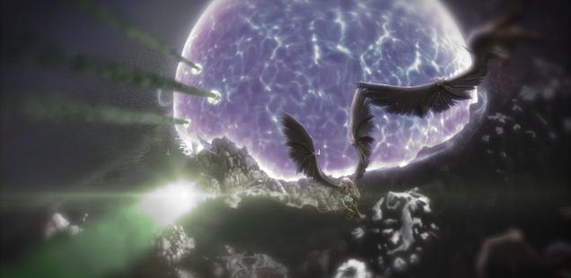
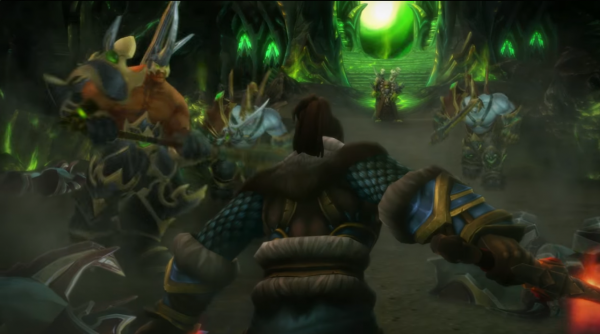
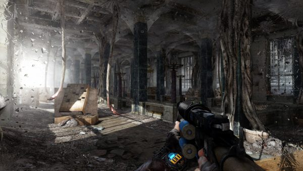
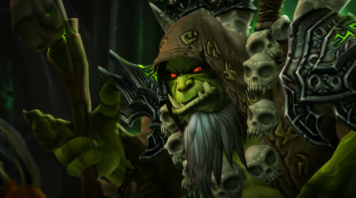

+++
title = "Playing For Real: Holding Out for a Hero"
template = "mirror.html"
extra.source_url = "http://www.haywiremag.com/columns/playing-for-real-holding-out-for-a-hero/"
extra.resolved_url = "https://haywiremag.com/columns/playing-for-real-holding-out-for-a-hero/"
extra.captured = "2026-10-20"
extra.kind = "article"
extra.raw_response = "source.html.txt"
+++

### Jesse Porch didn’t really do all those things he did.

This fall saw the much-anticipated release of *World of Warcraft’s* sixth expansion. *Legion* allows adventurers to return to a world once again threatened by the interdimensional forces of Chaos known as the Burning Legion. My priest, along with millions of other heroes, are recalled to the front lines to scrape together every sword, spell, and poorly documented goblin thingamajig we can and stand against a foe that threatens to bring about the end of the World (…of Warcraft).

Yet my daily interaction with the denizens of Azeroth places me invariably in one of two very different situations. Sometimes I’m hailed as *The* High Priest, who alone among all priests was able to purge the Netherlight Temple’s primary resident of darkness and single-handedly allow the order to survive near-certain demonic destruction. Other times I’m running yet another cookie-cutter quest to gather a village’s lost and stolen drums or to toss fish back in the river. Neither of these actually make me feel particularly heroic.

In fact, any time spent dwelling on the reality of the world in which I act leads to the inescapable conclusion that nothing I do really matters. Like many other games, *World of Warcraft* doesn’t simulate heroism, it emulates glory. Being a hero to the different groups in WoW doesn’t demonstrate virtue, merely patience. How ought games address this disconnect between experiencing glory and embodying actual heroism? More than anything, we need to think about how a complex system like a videogame frames player actions both in story and gameplay.

Saving the world, defeating a nemesis, saving a love interest—all these things are exciting, and it’s no wonder that we fill our popular media with this kind of “cheap heroism.” Much like a training montage allows the audience to skip through the boring part of a hero’s journey, games make liberal use of shortcuts that allow them to drop us right into the action and experience the high of victory without building foundation of heroic character. While games tend to model “great actions” on the part of the player, they rarely take time to delve into the depth of virtue and commitment fundamental to such heroic acts in the first place.

Miguel Sicart writes about the importance of context in developing compelling ethical gameplay in his essay “The Banality of Simulated Evil,” arguing that while we often conceive of games as just mechanical models of real-world actions, ultimately it’s the whole scenario that the player interprets when considering their actions’ meaning. Without a robust moral frame around their actions, and virtue and vice quickly lose all meaning no matter how much the game attempts to present compelling moral choices.  

While the consequences of this “banality of simulated evil” may seem trivial, Sicart is right that the same impulse to split the ethical context from the heart of our games damages the medium’s potential to demonstrate meaningful models of virtue. Instead of a meditation on the trials and tribulations of being a hero in a world beset by all manner of adversaries, *World of Warcraft* gives us a never-ending gear treadmill to simulate growth and a reputation grind instead of accolades—a banal simulacrum of what we expect heroics ought to feel like.

This not limited to MMOs and shows up in related forms through numerous other genres. Consider how single-player RPGs tend to contrive events that suddenly thrust the player character into multiple positions of power and prestige nearly from the outset. While framing a game’s story as a “chosen one” narrative is understandable, the goal is often more to make the player feel powerful and important rather than because it best serves the story. While I can accept that my *Skyrim* character is the Dragonborn—after all, someone’s got to be—it seems a bit strange that I can also end up as Archmage of Winterhold, Listener of the Black Hand, and Guildmaster of the Thieves’ Guild…at the same time! Fallout 4 suffers from a similar malady: while ultimately forced to choose a side from among the main factions, the fact that the player can quickly progress into the inner circles of the major powers with minimal interference dramatically undermines the prestige that such positions should represent.

Instead of dwelling on other poor examples, let’s consider one of my favorite examples of a nuanced take on heroic themes: *Metro 2033*. While at first glance it may seem just like the dozens of other story-driven shooters we’ve all played where the hero demonstrates their tenacity and skill repeatedly until they vanquish the threat and save the world, upon closer examination the game subverts that trend. While ultimately still the story of a remarkably gifted hero whose commitment triumphs over impossible odds, the game goes out of its way to cultivate a sense of vulnerability in everything the player does, offering modes that remove the HUD and make ammo and survival gear extremely rare. The higher difficulties especially place you in situations where your ability to advance is highly restricted by foes more powerful than you are, and success comes from understanding your limitations and coming into contact with them only when necessary.

While a typical “run and gun” approach works in many situations, on the harder difficulties survival is much more likely if you slow down and take time to understand your surroundings. The peaceful approach goes far beyond simply using the “nonlethal” button, such as learning how certain sets of enemies behave and figuring out how to cross through their territory without disturbing them. This is not dramatically different in mechanics from a nonlethal approach in games such as *Deus Ex: Mankind Divided*(whose flaws received [solid treatment](https://haywiremag.com/columns/due-diligence-stick-with-the-prod/) by Haywire’s own Leigh Harrison)*,* but the subtle distinctions in framing make a huge difference in the way the game feels. Enemies are more than just obstacles, human and monster alike all go about the details of their daily existence. Nonlethal approaches involve understanding enough of these details to bypass or neutralize the threat without destroying them in ways that *Deus Ex*’s memorizing of patrol routes and on-the-nose background chatter never seemed to manage.

In addition to enemy depth that helps to give emotional context to the gameplay, *Metro* also makes a point of punctuating the adventure with interludes of peace and quiet that still further the end. Notably, the villagers who populate the game’s towns are more than just props; they have lives and goals entirely tangential to Artyom’s quest. Pausing in the market to hear the variety of voices conducting trade and living their lives, paying a child to give a tour of the back alleys rather than staying on the obvious path—these actions are just as much a part of who Artyom is as his badass combat skills. Taking time to smell the roses frames the narrative in a refreshing way, centering the story not on Artyom’s fight against an evil force, but on the world that he’s fighting to preserve, something that most modern military shooters fail to integrate at all.   

Most interestingly, the game only allows the player to choose its peaceful “good ending” if they have amassed a sufficient quantity of “good points” from actions throughout the game. These points are awarded for actions such as saving a small child (and refusing to accept a reward), saving lives, and refusing to kill certain enemies, and other things like exploring the cities, talking to their inhabitants, and finding a guitar to play—actions that are not inherently “ethical” by nature. The implicit message is that making the “good” and truly heroic decision by recognizing the possibility of a peaceful solution requires a person with an inquisitive outlook. The hero is not the one who vanquishes all enemies, but who understands that not all fights must ultimately come to that.

Stories of heroes and their deeds are as old as human civilization, where they’ve played a chief role in the foundation of our shared human culture for as long as it has existed. But it’s crucial to understand these tales not as records of deeds, but as a deeper look at society and the values that cause great actions to be remembered as heroic ones. Mighty accomplishments divorced from this foundation amount to little more than Ozymandias’ granite legs half-buried in the sand.

JRR Tolkien was keenly aware that to truly resonate his story needed more than mere fantasy, it needed a firm grounding in the mundane life that gives heroes’ actions weight and purpose. In a letter to his publisher, Tolkien notes that “the simple ‘rustic’ love of Sam and his Rosie (nowhere elaborated) is absolutely essential to the study of his (the chief hero’s) character, and to the theme of the relation of ordinary life (breathing, eating, working, begetting) and quests, sacrifice, causes, and the ‘longing for Elves’, and sheer beauty.” He viewed the mundane as key to properly understanding Sam’s heroism, which was itself based on his faithfulness, dependability, and perseverance.

Sadly, our games often go to great lengths to skip past that in favor of a nearly exclusive focus on might of arms, producing games that are exciting power fantasies that lack any true sense of heroism. While *Metro 2033* show us that games can can portray a deeper kind of heroism and do more than just slake our thirst for glory, games like *World of Warcraft* just rely on flashy cutscenes and epic boss-fights to make us feel like we’re big damn heroes.  Videogames could stand to have a lot more Sam Gamgees, those who are heroes not because they do great things but because they’re heroic people. A hero whose character is rooted in the mundane for us to relate to yet whose actions never devolve into the banal. That’s the kind of hero I want to play.

---

*Jesse Porch is a software developer who enjoys dabbling in videogame scholarship, especially the cultural role of play in ethics, empathy, and relationships. Check out his other work* [*here*](http://www.jmporch.com/)*.*
