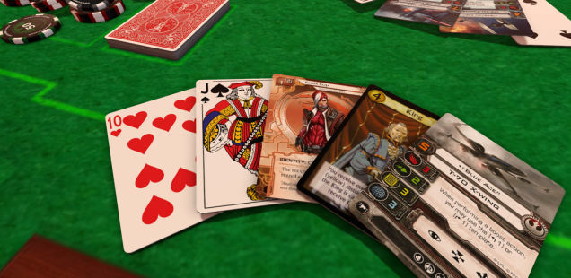
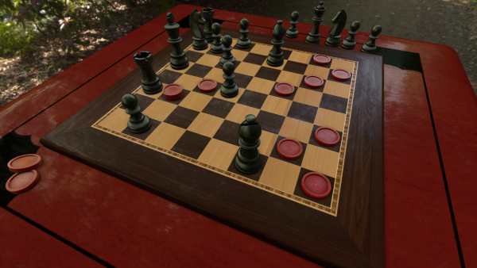
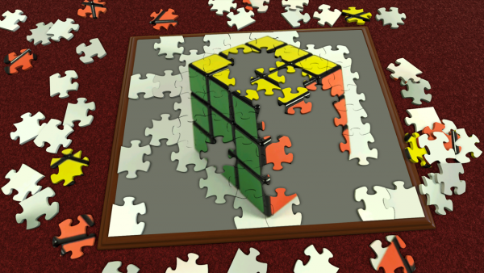

+++
title = "Playing For Real: Let There Be Play"
template = "mirror.html"
extra.source_url = "http://www.haywiremag.com/columns/playing-for-real-let-there-be-play/"
extra.resolved_url = "https://haywiremag.com/columns/playing-for-real-let-there-be-play/"
extra.captured = "2026-10-20"
extra.kind = "article"
extra.raw_response = "source.html.txt"
+++

### Jesse Porch is, uh, just quoting God.

In 1988 noted drama professor Richard Schechner proposed a “moratorium on the defining of play.” Unsurprisingly, for the past thirty years many scholars have decided not to take him up on his suggestion. But whether or not there’s much point in trying to nail down what specifically “play” is, doesn’t the effort invested in answering the question indicate that whatever it is, play matters? [V](https://mitpress.mit.edu/books/play-matters)[ideogame scholar Miguel Sicart](https://mitpress.mit.edu/books/play-matters) thinks so and claims “play is a manifestation of humanity, used for expressing and being in the world.” Any practice we use for embodying ourselves within the world deserves our careful consideration.

Unfortunately, many of us have learned to ignore the importance of play as a part of our day-to-day lives. Intentional play is not something to grow out of, nor is it a supplement to our human existence; it is one of our defining characteristics. Renowned theologian [Romano Guardini](http://www.goodreads.com/book/show/511397.The_Spirit_of_the_Liturgy) didn’t shy away from acknowledging the playfulness within Catholic liturgy, saying that, like play, it is “life, pouring itself forth without aim, seizing upon riches from its own abundant store, significant through the fact of its existence.” Guardini proposes that things can be meaningful whether or not they fulfill any sort of utilitarian purpose. He sought to dispel the idea that liturgical practices were valuable only so far as they taught a lesson or conveyed a clear message. Rather, they were acts that allowed the faithful to delight playfully in God’s presence.

Thinking of liturgy in this way avoids two harmful conclusions: that it is some sort of code to be deciphered to get the “real message”, or that it is a meaningless ritual performed merely as a show of unity. Liturgy matters by the fact of its existence — its components formed and refined through the centuries that transcend mere practical and aesthetic concerns. Gaurdini’s examination comes to a similar conclusion:  “To be at play, or to fashion a work of art in God’s sight — not to create, but to exist — such is the essence of the liturgy.” Guardini has no qualms with comparing liturgical practice with a the play of a child; he views it not as trivialization but as a glimpse of a deep truth that we often think ourselves too “grown-up” to acknowledge.  
  
The observation that playing is not only worthwhile but crucial for developing our humanity is not new. The field of Game Studies owes a great debt to the anthropologist Johan Huizinga, who articulated the concept of a “magic circle” or “world within a world” that play brings into being. This impulse to pursue actions that are set apart from the realities of daily life comprise a foundational element of all human society that predates recorded history. He subtitled his [1938 book](http://www.goodreads.com/book/show/233221.Homo_Ludens) “The Play Element of Culture” because the alternative “element *in* culture” mistakenly conveys a sense that play is just a part of culture; instead, he argued, “culture itself bears the character of play.”

Of course, humans are not the only creatures that play, so the fact that we play fails to fully articulate why it matters to us. In fact, the important thing about play is that it doesn’t fully make sense, at least not according to the calculus of productivity. In Huizinga’s words, “The very existence of play continually confirms the supra-logical nature of the human situation…We play and know that we play, so we must be more than merely rational beings, because play is irrational.” The irrational nature of play does not undermine its value; Huizinga’s use of the prefix “supra,” meaning “above,” stands in stark contrast to a more natural option such as “illogical”. The human need for play is rooted in our ability to transcend mere reason without disregarding it entirely. The fact that we find fun within something as “pointless” as play does not indicate a weakness in human understanding, but a strength that too often is left unacknowledged.

This has dramatic implications for what we consider meaningful play. If meaning comes not from viewing games as a means to an end—be it aesthetic enjoyment, problem solving skills, or even faster reflexes—but instead from the act of play itself, then worries that play is an just empty timesink fall apart. Such assertions risk dismissing an entire medium on the shaky premise that only that which fits within a rigid view of usefulness is worth our time or consideration. A healthier perspective that accounts for the inherent meaning of playfulness looks at games not as a means to a productive end, but instead as a scaffolding from which we build out our human nature. By interacting without concrete objectives, content to merely enjoy our actions for their own sake, we play and we acknowledge that we play, and in doing so we become more human.

Interestingly, many complaints about videogames today bear a striking similarity to the cultural consensus about fairy tale that J.R.R. Tolkien faced in his day. Such stories were said to be pointless make-believe for amusing children — escapism and fantasy that distract from important matters once one entered the real world. Tolkien insisted that such dismissive views not only misunderstood the depth of fairy tales, they undermined the crucial role that such stories had within the development of culture itself. Tolkien’s views of fairy tale align closely with Huizinga’s perspective on play itself: both represent a primal element of human culture whose existence precedes most elements of what we call culture. Mankind’s basic building blocks are not math or science, but play and story. In this spirit, perhaps the most foundational questions facing videogame critics, designers, and players today are not “what use are videogames” or “are videogames art?” but is instead “how do videogames enable us play meaningfully?”

For example, consider Roger Ebert’s conclusion that “[Videogames can never be art](http://www.rogerebert.com/rogers-journal/video-games-can-never-be-art)”, which has rightly provoked a variety of responses from the videogame community. Some have provided examples of existing games that should be considered art, while others focus on the potential for the medium to attain that status even if it has not yet reached it. Many fairly questioned what the term art even means, a point that Ebert conceded he never really dealt with — nor desired to deal with. In a sense his [follow-up](http://www.rogerebert.com/rogers-journal/okay-kids-play-on-my-lawn) could be read as a concession, but such a victory seems hollow. As Ebert says, why does it matter if games are, will be, or ever can be art? Compared to the broader context of play and its role in human society, the “games as art” movement risks defending the abstract value of games so single-mindedly that we lose sight of the tangible value of the play that they enable today. It’s fair to want games to be recognized for their artistic merit, but it’s equally important that we consider how a proper understanding of play can help us better engage with games as tools to foster playfulness for its own sake.

In Sicart’s manifesto, he arrives at a similar conclusion and points out that play appropriates its object, thus “playfulness allows us to extend the importance of play outside the boundaries of…designed playthings like toys [or games]…[Playfulness] shows its actual importance not only in the making of culture but also in the very being of human…We are because we play, but also because we can be playful.” More fundamental than seeking better games to play is the quest to learn to play what games we have in better ways. By understanding play as a human trait that games simply provide concrete manifestation of, we can discern how best to seize upon their abundant store of riches, to engage with their inherent significance and meaning for its own sake.

Guardini and Sicart come from different perspectives, but both agree that playfulness is not an indication of triviality but of primal meaning that is too often ignored. Guardini argued that through play we are drawn closer to God, and Sicart that through play we live out our humanity to its fullest potential. In light of this, the objects of our play — religious ritual, bedtime stories, or videogames — deserve our utmost respect, not just as interesting artifacts, but because of what they encourage within us. So, to paraphrase a famous quote… “Let there be play.”

---

*Jesse Porch is a software developer who enjoys dabbling in videogame scholarship, especially the cultural role of play in ethics, empathy, and relationships. Check out his other work* [*here*](http://www.jmporch.com)*.*
