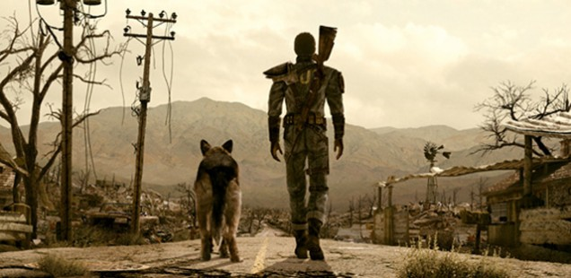
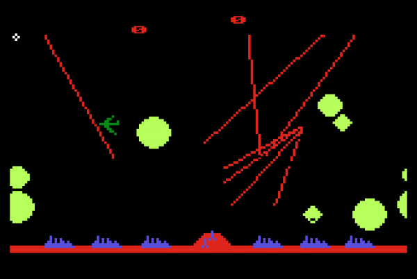
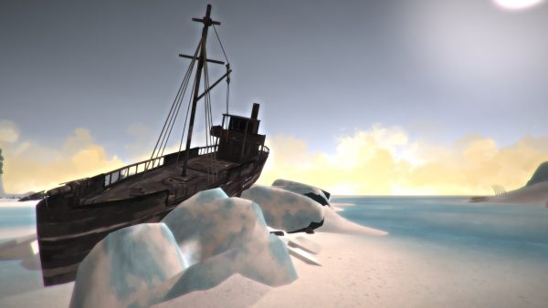

+++
title = "Playing For Real: Not With a Bang but a Winter"
template = "mirror.html"
extra.source_url = "http://www.haywiremag.com/columns/playing-for-real-not-with-a-bang-but-a-winter/"
extra.resolved_url = "https://haywiremag.com/columns/playing-for-real-not-with-a-bang-but-a-winter/"
extra.captured = "2026-10-20"
extra.kind = "article"
extra.raw_response = "source.html.txt"
+++

### Jesse Porch just wants to set the world on fire.

The end of the world is surprisingly well-traveled ground these days. Our fascination with the annihilation is certainly not a new phenomenon, and has been a core part of videogames’ DNA ever since *Missile Command* tasked players with a futile attempt to avert a rain of atomic fire. While *Missile Command* placed the player in the world’s final moments, famously concluding with “The End” superimposed over a circle of fire after the player has inevitably failed, many similar stories instead focus on what follows after the world has “ended.”

Popular media is replete with distinct portrayals of things coming to a cataclysmic end. Whether by meteor impact, alien invasion, zombie plague, or something more mundane like nuclear annihilation, we love watching the world as we know it fade away. Likewise, T.S. Eliot’s *The Waste Land*—one of the most important poems of the twentieth century—envisions a world of purgatorial suffering and death. His later works continued to incorporate this sort of imagery, but with a slightly more hopeful perspective; *Little Gidding* ends with a meditation that “the shame/Of things ill done and done to others’ harm…From wrong to wrong the exasperated spirit/Proceeds, unless restored by that refining fire…”

We commonly use the term “apocalyptic” to refer to such end of the world scenarios, whether they focus on the point of destruction or its aftermath. However, the word’s literal meaning instead refers to uncovering or “lifting of the veil.” Traditionally, apocalyptic literature was a form of religious writing that dealt with the supernatural destruction of the current order, but the destruction itself was not meant to be the focus. Rather, the writers used stories of destruction to impart wisdom about the true nature of reality. By envisioning the end of the world as they knew it, the audience could glimpse beyond their own experience to the underlying fabric of the world. Indeed, the most well known example of ancient apocalyptic literature is the Apocalypse of John—commonly known as the Book of Revelation—in the Christian New Testament.

Looking at the apocalypse not as the end of the world, but as fire that refines it, provides a helpful framework for reading works dealing in this subject. A fascination with the end of days may be far more than a nihilistic delight in destruction. While “zombie modes” in games have become commonplace as a way to provide a simple frame to justify endless waves of slaughter, other stories make far more powerful use of the living dead as a way to examine deeper truths. Though it has now been used to the point of cliche, the idea that “humans are the real monsters” has been a staple of zombie fiction since George Romero’s *Night of the Living Dead* popularized the modern conception of  zombies.

Other examples, such as Telltale’s *The Walking Dead* series, reach a bit further and use the backdrop of the zombies to examine the reality of raising a child in a harsh world, exploring the tradeoffs between preserving some measure of innocence versus preparing a child to face the world as it is. The same themes could be addressed in a variety of contexts, but framing it amidst the apocalypse allows the writers to pursue far more extreme questions and pose more intense moral quandaries.

*Fallout* is rightly considered a classic, and its tone, setting, and aesthetics are certainly worthy of praise, but what answer does it seek to find from beyond the veil? We see a world dramatically transformed by nuclear fire, mysterious viruses, and societal breakdown, but at the end of the day things continue as they always have amidst the rubble. The Wasteland may be harsher than the world before the bombs fell, but people still build homes, have families, and live their lives as they always have. Even the games’ famous opening monologues point to an eternal order of things: war, war never changes. *Fallout 2* adds that “The end of the world occurred pretty much as we had predicted. Too many humans, not enough space or resources to go around. The details are trivial and pointless, the reasons, as always, purely human ones.”

In the world of *Fallout*, the “deeper reality” is ultimately a continuation of the same forces at work in the present world. The apocalypse is brought about by a combination of humanity’s greed and destructive ingenuity, resulting in a world that survives primarily through human resourcefulness to return to a reasonable approximation of the prior civilization whose ruins it inhabits. Many of the game’s factions, especially the Enclave, literally represent a direct continuation of the prior order, and actively seek to direct the new world to fulfil the same vision they always have. But the human flaws that led to the bombs are brought to the surface with the reduction of human social structures designed to contain them.  If anything, post-apocalypse intensifies humanity’s ugliness: many of the games’ stories center around those who wish to harness the power of the Old World to use for their own ends in the new.

*The Long Dark* by Hinterland Studios presents a very different take on the apocalypse. Rather than a man-made catastrophe, the end comes through a “quiet apocalypse” of purely natural means—a powerful magnetic storm. “[Everything that has shielded humanity from the disinterested power of Mother Nature](http://hinterlandgames.com/the-long-dark/)” is, in the blink of an eye, reduced to scrap. The player, trapped in the Canadian wilderness, can survive only by scavenging amidst the husk of the old world, eking out a meager existence as the remnants of society fade away. Crucial supplies such as food, medicine, and clothing are scattered about for the taking, but the bodies of the less fortunate also dot the landscape and provide a valuable source of supplies, driving home the point that you survive only because so many others did not.

*The Long Dark*’s apocalypse lacks the ferociousness of *Fallout*’s atomic war, and the changes to the world certainly seem far less intense than the mutations of the Wasteland. But its bitter winter conceals a horrifying implication that the society has fallen not to our own power but because nature doesn’t give a damn about all that we’ve managed to build. The ruins that once represented humanity’s dominance over nature now stand as silent corpses whose only remaining value lies in the few scraps that the survivors can find within them.

While *Fallout* and *The Long Dark* present two substantially different views of the apocalypse, they both draw on the same heritage, using the transformative power of destruction to give a window into a deeper reality. *Fallout* allows the backdrop of complete nuclear destruction and societal breakdown to shift the tone of its portrayal: in the light of near total destruction, the pillaging and murder of the Wasteland is almost comical. *The Long Dark* opts instead to strip away the trappings of modern life, challenging the player to live in a world where their every effort is needed to gather the bare necessities. Both use the apocalyptic shift to frame different aspects of life in the world that comes to be, presenting very different glimpses of “real” humanity.

T.S. Eliot’s intimate familiarity with the death and destruction of two World Wars gave plenty of opportunity for soul-search. He had seen enough death and destruction first hand during the London Blitz that he knew the fragility of human life, but he had also seen the resilience of society in the face of evil, and from that he found glimmers of hope that the ashes of war would not be the end of things but a foundation for the world that would follow. Though most of *Little Gidding* focuses on destruction, its final stanzas shift radically in tone, evoking Julian of Norwich’s assurance that “All shall be well, and all shall be well and all manner of thing shall be well.” By embracing the apocalypse, understanding that it is not about destruction but transformation, we are able to pierce the veil and, with a bit of dedication, fulfill Eliot’s vision that “the end of all our exploring/Will be to arrive where we started/And know the place for the first time.”   

---

*Jesse Porch is a software developer who enjoys dabbling in videogame scholarship, especially the cultural role of play in ethics, empathy, and relationships. Check out his other work* [*here*](http://www.jmporch.com/)*.*
