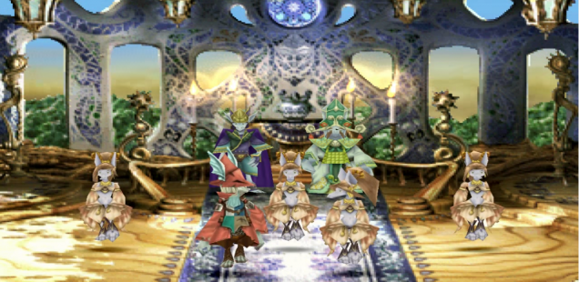
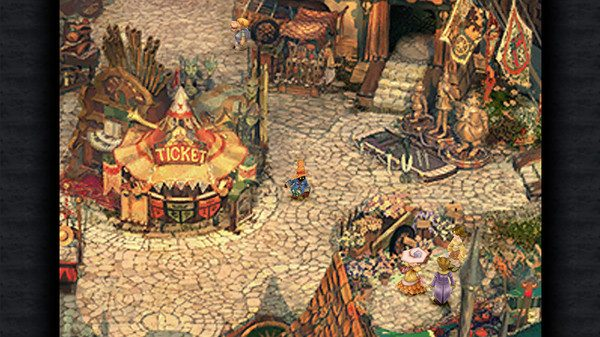
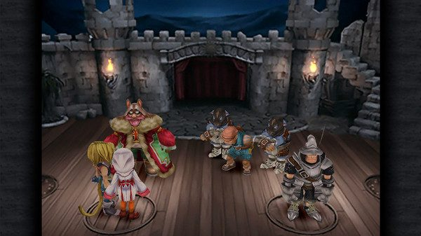

+++
title = "Playing For Real: Play As You Like"
template = "mirror.html"
extra.source_url = "http://www.haywiremag.com/columns/playing-for-real-play-as-you-like/"
extra.resolved_url = "https://haywiremag.com/columns/playing-for-real-play-as-you-like/"
extra.captured = "2026-10-20"
extra.kind = "article"
extra.raw_response = "source.html.txt"
+++

### Jesse Porch Wants to be Your Canary.

A melancholy philosopher once mused that  “all the world’s a stage, and all the men and women merely players.” The speaker’s cynicism is almost palpable: despite our greatest efforts, all we do amounts to nothing more than reading lines and following directions we haven’t written amidst a set we didn’t make. Our role is defined for us, our entrance and exit beyond our knowledge or control, and we’re not even the main character! Perhaps the world *is* a stage, and we are all players, but there is nothing “mere” about that.

But what does it mean to play along? In his newest book *Play Anything*, game scholar and slightly less cynical philosopher Ian Bogost argues that to play is to navigate within a constrained space and optimize the outcome in accordance with limitations. While he obviously speaks of playing in a sense other than the theatrical, it’s no accident that both acting and gaming share the verb. Anthropologist Johan Huizinga proposed that play is the process through which culture is produced, so it seems fitting that such a culturally significant pursuit as theater would borrow the term. Bogost’s definition of play seems particularly relevant to thespian endeavors: “To take something–anything–on its own terms, to treat it as if its existence were reasonable.”

*Play Anything* contends that approaching the variety of things life throws our way, from the mundane tasks of buying groceries to the major life decisions we all must face, inherently requires accepting some form of limitations and choosing to make the best of them. We cannot, in fact, be whatever we want: try as I might, I will never fulfill my dream of being a Second Age Numenorean prince. Accepting this premise does not entail embracing pure fatalism and abandoning agency entirely. Just as the winner of a game must have rules that establish his victory, so a life well-lived requires constraints and challenges that frame one’s accomplishments.

As a society, we’ve always had a fascination with the human condition and what sorts of constraints we find ourselves under. Whether it’s divine will, impersonal fate, or blind chance, there has always been an understanding that something outside of ourselves influences our options. Bogost remarks that “instead of seeing freedom as an escape from the chains of limitation, we should interpret it as an opportunity to explore the implications of inherited or invented limitations.” This applies just as strongly to the limitations of a role in a play as to limitations conveyed by our roles in real life.

By nature, a play consists of a strong set of constraints and impositions that its players must accept in order to pursue their craft. Actors put forth immense effort to conform themselves to strict guidelines on their speech, dress, and action. Yet no one holds that these constraints inhibit their humanity. On the contrary, the great actors of our time can both embody the roles proscribed and transcend them to make the character truly their own. If the world’s a stage, then it need not be said that we are *merely* players, for it is precisely within the limitations of play that our creativity is given its chance to shine.

*Play Anything* provides a variety of examples that illustrate Bogost’s point, but being somewhat partial to the theatrical metaphor, I now direct your attention to a videogame that likewise adopts a theatrical motif to develop a similar theme. *Final Fantasy IX*’s colorful cast provides numerous examples of characters who must confront the limitations of their station in order to rise above. Whether by their nature, station, or personality, each is unsatisfied with their lot in life and their ultimate victory comes not from submitting to such limits nor from denying them entirely–ultimately they find ways to rise up within their roles in a way that stretches beyond the edge of what seems possible yet remains faithful to who they’ve always been.   

*Final Fantasy IX* takes the metaphor farther than just theme and aesthetic, building much of its story around direct references to plays and theater. The protagonist’s band of thieves also happen to be a traveling troupe of performers. References to in-universe theatrical works pepper the dialog of various characters–the game begins and ends with a performance of *I Want to be Your Canary*, which itself parallels the princess-and-peasant plot of the main story. On a more sinister note,  the game’s villain Kuja is himself prone to the theatrical, comparing his manipulation of the inhabitants of the various kingdoms to that of a playwright or a puppetmaster.

The latter view takes on literal significance, as one of Kuja’s primary roles is the instigation of a major war by granting one of the kingdoms the ability to construct “black mages”, animate dolls that wordlessly obey their masters’ bidding. Fittingly, Kuja views this as a supreme irony, for in making use of these golems his “allies” prove to be his true puppets, their battles to win themselves more power and influence serving ultimately to further his schemes that will ultimately lead to their own downfall. No doubt he would agree with Shakespeare’s Melancholy Jaques in saying that all are *merely* players in a stage as large as the world. The irony becomes complete late in the game when it is revealed that Kuja is himself a created being intended to serve his own creators, but due to his awareness and free will he rejects that role and chooses to work to thwart their goals with a nihilistic approach instead.

One product of Kuja’s machinations is Vivi, a playable character and prototype black mage who has himself awakened to sentience and wanders aimlessly having lost the closest thing to family he had found. Vivi also struggles with the revelation that he was created, literally, as a puppet to perform another’s bidding, and his character growth is based around both coming to terms with the reality of his existence but being able to move forward as his own person rather than simply fulfilling others’ expectations. For Vivi, being a player rather than a puppet means accepting the fact that regardless of his origins and creator’s intentions, he is able to forge friendships and seek to help others rather than blindly kill and destroy.

Perhaps a more relatable example comes in Adelbert Steiner, Captain of the Knights of Pluto. Steiner’s role as a sworn protector of the royal family gives his life purpose and direction, but when he seemingly must choose between following orders and protecting his charge the precarious nature of his role becomes evident. If we view these obligations as mere rules, Steiner’s options are slim: there’s virtually no way to meet his commitments entirely, which means that he’s a failure as a servant. Yet Steiner comes to terms with his quandary and discovers that he can rise to the occasion and become a true hero: rather than strictly following orders, he seeks to investigate and judge for himself what path leads to the best outcome for the queen, princess, and kingdom that he serves. By embracing his agency, Steiner becomes more than a hired hand while at the same time fulfilling his job in a much more thorough way.

The trademark of good drama is characters who, when faced with their limitations, accept their roles but don’t submit to them. We all love to hear about the lovable rogue who sacrifices for the greater good yet maintains enough of his outlaw nature to remain interesting. This same process occurs at a higher level, too, as the most moving actors are those who embrace their parts and make them their own, working within the script and direction while still delivering their own take on the story to be told. *Final Fantasy IX* provides a solid representation of these tropes, and by embracing the theater motif as a literal representation of the process through which most of its major characters are going, it provides an endearing and memorable way to portray this principle in action. Perhaps the whole world is a stage, and we are all players. But we need not be merely players, for the beauty of play is that rather than boxing us in, a bit of play lets us be more than any mere script dictates.

Just as Ian Bogost asserts, true freedom lies not in infinite possibility but in an imagination that accepts constraints and learns to run wild with them. This principle is the foundation upon which art has always been built, but often we need a reminder that a little playfulness can go a long way towards improving our lot in life. Games like *Final Fantasy IX* are valuable way to practice accepting constraints and finding ways to flourish within them.

---

*Jesse Porch is a software developer who enjoys dabbling in videogame scholarship, especially the cultural role of play in ethics, empathy, and relationships. Check out his other work* [*here*](http://www.jmporch.com/)*.*
