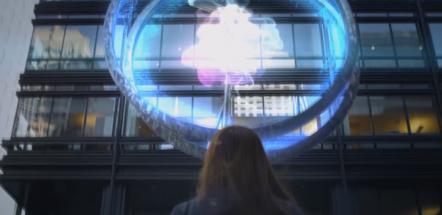
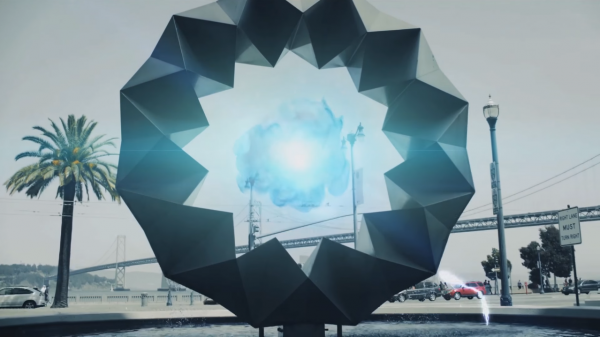

+++
title = "Playing For Real: Reality, Augmented"
template = "mirror.html"
extra.source_url = "http://www.haywiremag.com/columns/playing-for-real-reality-augmented/"
extra.resolved_url = "https://haywiremag.com/columns/playing-for-real-reality-augmented/"
extra.captured = "2026-10-20"
extra.kind = "article"
extra.raw_response = "source.html.txt"
+++

### Jesse Porch is in a world of his own.

“The world around you is not what it seems.”

A single sentence of warning adorns the [website](https://www.ingress.com/), which includes a link to a short [video](https://www.youtube.com/watch?v=Ss-Z-QjFUio). Those curious enough to watch the video are presented with a litany of narrators rambling about strange phenomena occurring around local sculpture and architecture. The narration doesn’t make much sense—a disjointed collection of unidentified voices talking about secret projects, mind control, anomalous energy readings, and mysterious organizations. It ends with a vague indication that “it’s time to move,” but lacks any directions on how to do so.

This scene could easily be taken for any of the myriad of cliché conspiracy theories swirling around the internet, and that appearance is wholly intentional. All this material is part of the official website for *Ingress*, a mobile game developed by Niantic, Inc. Digging into the backstory—something not many of its players tend to do—reveals a bizarre amalgam of science fiction, cyberpunk, and conspiracy theory.

Alien intelligences known only as “Shapers” are using strange particles of “Exotic Matter(XM)” to communicate through space and time. Shadowy corporations and government agencies have formed around this discovery, splitting into opposing teams: the Enlightenment who believe the Shapers wish to guide humanity into a new stage of evolution, and the Resistance led by a mysterious AI with her own designs for human development. Both factions clash constantly, using XM-enhanced technology to turn their mundane devices such as smartphones into “scanners” capable of detecting and interacting with the portals that seem to generate the XM. Yet in keeping with the conspiracy theme, for all the secret knowledge available there are always whispers of plots that run even deeper than either side knows.

What makes *Ingress* interesting is not its convoluted story, nor its minimal gameplay. Rather, it works because it unifies a variety of components with a shared theme that pulls things together in a consistent way. *Ingress* is built around augmented reality, “[a technology that superimposes a computer-generated image on a user’s view of the real world, thus providing a composite view](http://www.oxforddictionaries.com/us/definition/american_english/augmented-reality),” but the game goes beyond this single layer and applies the concept to multiple levels of its design. “Augmented reality” in *Ingress* is not simply a technological way of presenting the game to players, it is reflected in the thematic intersection of all the game’s elements. The concept even extends beyond the immediate game, with promotional and story videos often containing hidden codes and puzzles that many in the [community](http://decodeingress.me/2014/09/16/passcode-decoding-walkthrough-012/) race to uncover.

For instance, both the gameplay and backstory are built atop the conceit of assigning higher significance and purpose to real world locations and points of interest. Niantic applies the augmented reality premise to the story and the mechanics, creating a one-to-one scale representation of the entire globe and basing all in-game activities within it. This simultaneously reinforces the theme of covert global conflict—a “true reality” that only players with their specialized hardware and software are able to glimpse—and gives the game a sense of scale and scope beyond what the simple mechanics would convey on their own. By providing limited tools to interact with this additional layer of reality that spans the globe, *Ingress* appropriates the whole world and leverages it to incorporate real-world activities from walking or biking all the way to intercontinental flights and boat and helicopter charters into the gameplay itself.

A similar observation can be made of the game’s community. Players choose to support one of the game’s two factions, and mechanically they are able to reinforce allied positions or destroy enemy ones. The mechanics further encourage teamwork by limiting what an individual player can do: even at the highest level, a single player cannot fully upgrade the portals that provide the in-game items needed to perform most basic actions. While a few allied players working together can do a bit better, to create a fully upgraded portal requires eight fully-leveled players to contribute.

The game provides basic communication tools, these are of limited use to coordinate for even these relatively simple tasks. Many players thus turn to external communication tools that can better handle such communications–both to accommodate the scale of interaction and to provide for enhanced security and avoid spies eavesdropping on sensitive communications. Such groups often rely on multiple strategies to keep safe, from in-person meetups with any prospective recruit to accepting only those with a referral from a verified member. This in turn leads to the formation of more complex communities and groups far more granular than the game’s two teams, such as regional communities dedicated to bringing local players together regularly for accomplishing complex tasks and sharing gear. Others go beyond the local and develop inter-regional communities that span countries or continents, connecting travelers with fellow players wherever they visit. These communities represent another layer of the composite reality that *Ingress* embodies: while they exist because of the game, they transcend what the game itself directly facilitates, adding a level to the game beyond the bare mechanics or backstory.

A deeper example of complexity comes when the social and mechanical elements merge, as demonstrated by the game’s method of keeping score based on the mechanic of “fielding”. Portals can be linked to other friendly portals through the use of a “key”. These links can cover substantial distances, but cannot cross any existing links. When joining nearby portals this is not much of an issue, but when making large links through dense groupings of portals, the casual links can quickly block more ambitious ones. If agents manage to completely link three portals together, the closed triangle becomes a “field” that gains points for the associated team. Much of *Ingress*’ organic “endgame” comes from planning and executing large or complex fields, mostly for the bragging rights that come from pulling it off.

Because the keys are only obtainable from their respective portal, real-world geographic concerns are important for operations to construct large fields. These keys are an in-game item that can be traded, but only to players in your immediate presence. If a player wishes to make fields beyond their local region, they need to receive keys from a distant source and ensure that the path to that target is clear of other links. Thus the communities must cooperate on a cross-regional scale, often through the creation of additional subcommunities to divide such massive undertakings into manageable components. Extreme examples, like “Unight8”, an operation to complete a set of links surrounding the globe, have demonstrated just how [committed](https://docs.google.com/document/d/1I4JYFqvl4sVUV0KVztCvepiHXFwYlmlOFyKKfml374M/edit) various agents have been to the cause. In this case, dozens of agents all around the world worked for months to plan, organize, set up, and ultimately execute numerous individual operations crucial to the ultimate success of Unight8. While far from typical, such exchanges, relying on multiple players traveling many thousands of kilometers each to ensure keys were in position within strict time constraints, give a glimpse of the *Ingress* community’s role in defining and expanding the domain of play.

These sorts of mechanical and technological factors all build off of the layered reality motif that is fundamental to augmented reality, and the way *Ingress* weaves the theme into its many facets enhances the effect throughout them all. In particular, basing the game on a story that draws heavily from conspiracy tropes is an excellent way to keep such a complex mix together: this sort of “gnostic wisdom” accessible only to the chosen is exactly the sort of thing from which conspiracy theories are crafted. Tying the game’s fiction to the platform upon which it’s played also enhances the experience. Because the game acknowledges being “played” using smartphone technology, the fact that players must resort to other communications technologies to play it most effectively does not come across as “metagaming” but instead as another way of embracing the framing narrative.

*Ingress* is ultimately a solid example of what can happen when the mechanics of a game are properly integrated on multiple levels with other crucial layers: the aesthetic, narrative, technological, and the communal domains all working together to convey a unified experience that is greater than the sum of its parts. By incorporating all these elements into a single package, Niantic has produced a compelling example of a game concept that can only exist as a digital artifact. In doing so, they’ve demonstrated how even “just” a game can encourage players to engage with the “outside world” in new ways, and in some cases even deepen their connection to their surroundings. Being firmly rooted in reality makes the game wider than if it was built from scratch. It serves as a powerful example of gaming used to lean into reality rather than to replace it.

---

*Jesse Porch is a software developer who enjoys dabbling in videogame scholarship, especially the cultural role of play in ethics, empathy, and relationships. Check out his other work* [*here*](http://www.jmporch.com/)*.*
