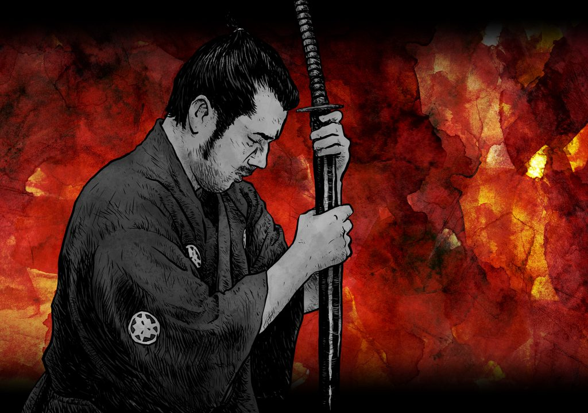

+++
title = "Sheathing the Sword: Akira Kurosawa and the Virtue of Meekness"
template = "mirror.html"
extra.source_url = "https://christandpopculture.com/sheathing-sword-akira-kurosawa-virtue-meekness/"
extra.resolved_url = "https://christandpopculture.com/sheathing-sword-akira-kurosawa-virtue-meekness/"
extra.captured = "2026-10-20"
extra.kind = "article"
extra.raw_response = "source.html.txt"
+++

[Seth T. Hahne](http://goodokbad.com/)

This post is featured in the ***[*CAPC Magazine,* January 2018: Change Agents](https://christandpopculture.com/capc-magazine-january-2018-change-agents/)*** issue of *Christ and Pop Culture Magazine*. Subscribe to *Christ and Pop Culture Magazine* by [becoming a member](https://christandpopculture.com/subscribe/) and receive a host of other benefits, too.

Japanese film pioneer [Akira Kurosawa](https://www.google.com/url?sa=t&rct=j&q=&esrc=s&source=web&cd=2&cad=rja&uact=8&ved=0ahUKEwjw0uSYx__YAhUMvFMKHbxcCK0QFggzMAE&url=http%3A%2F%2Fwww.imdb.com%2Fname%2Fnm0000041%2F&usg=AOvVaw2NzfEx_T6CSk1X3cohi5xx)’s filmography contains many of the industry’s most influential movies. His works played a crucial role in building out the Japanese film industry in the wake of World War II, but their influence on western cinema is also significant—both in direct remakes such as *A Fistful of Dollars* as well as a legacy of inspiration for an entire generation of directors. Though especially famous for his camerawork and editing, as well as studious attention to detail, his movies also powerfully convey a sense of humanity through both the heroes and the common folk that populate them.

While Kurosawa’s works are varied, addressing complex themes in a variety of Japanese settings, his numerous samurai films have a special resonance with audiences and played a key role in cementing numerous tropes in the cultural imagination of western cinema. His sweeping epic, [*The Seven Samurai*](https://www.google.com/url?sa=t&rct=j&q=&esrc=s&source=web&cd=1&cad=rja&uact=8&ved=0ahUKEwiQy86sx__YAhUGrFMKHZ9PCqQQFggoMAA&url=http%3A%2F%2Fwww.imdb.com%2Ftitle%2Ftt0047478%2F&usg=AOvVaw3gB2p6-1EG1dgeHsldNBgj)—which was adapted with only slight modifications as classic American western [*The Magnificent Seven*](https://www.google.com/url?sa=t&rct=j&q=&esrc=s&source=web&cd=1&cad=rja&uact=8&ved=0ahUKEwiasqGlx__YAhUIrFMKHXySD-sQFggoMAA&url=http%3A%2F%2Fwww.imdb.com%2Ftitle%2Ftt2404435%2F&usg=AOvVaw1A9eGdGZP9wOrXPtMkd7Z9)—is itself a reflection of Kurosawa’s position at the junction between East and West, blending elements of western and film noir with feudal Japanese history and culture.

Likewise, the movie’s theme deals heavily in the impact of western culture and technology, namely firearms, as they are integrated into traditional Japanese society. The titular samurai, like the knights of western history, are born from a world where developing martial prowess was an expensive endeavor, requiring economic patronage and a lifetime of dedicated training. Both traditions recognized this fact by placing these warriors within a cultural code of honor; similarities between the knights’ chivalry and the samurai “bushido” are not accidental, as they each serve a similar role in the ordering of their respective feudal societies. And in both societies, the rise of accessible firearms dramatically adjusted the social framework for viewing war and warrior alike.

Though our society is not built atop a system of knights and warlords, the theme of “might makes right” permeates entertainment and politics, and painfully shapes the stories we hear on the nightly news.

It is this disruption which gives *The Seven Samurai* its core sense of drama. A small village, besieged by a roving band of thieves and without a strong feudal lord protecting it, decides to appeal to the remnants of the old order to protect them from danger. The irony in seeking to hire samurai—now technically “ronin” who lack a formal relationship with the nobility—notwithstanding, the premise of a small band of elite warriors fending off a horde of unskilled thugs is a common trope. But with the addition of firearms, the drama intensifies, resulting in a powerful tale of the costly triumph of the seven’s painstakingly acquired skill, guided by their commitment to bushido, which ultimately leads to the villagers’ freedom. Interestingly, the leader of the samurai ends the movie with the observation that the victory belonged to the villagers themselves, driving home the film’s commentary on the inversion of roles, the noble samurai having bled and died to win the day for some farmers paying them a few handfuls of rice.

This talk of honor and the formal commitment to a code of virtue is not merely for show, however. Instead, it ties into a broad theme of the role of power, particularly the violent sort, which Kurosawa addresses in many of his movies. In *Sanjuro*, the main character (also a ronin played by Kurosawa’s frequent leading actor Toshiro Mifune) is taken aback when he saves a hostage who proceeds to criticize him for being a “sword without a sheath.” An old warrior like Sanjuro can’t help but get the clear implication: while a well-made sword is a powerful tool, if brandished inappropriately it’s unlikely to accomplish much more than injury and destruction of its user. Far better for a sword to be kept safely in its sheath, drawn only in great need. In his zeal to fight the good fight, Sanjuro frequently resorts to staggering levels of violence (in *Sanjuro’s* prequel *Yojimbo*, for instance, he “resolves” a gang standoff by manipulating the gangs into destroying each other to a man, taking out most of the village in the process). This idea of power that is useful because it is restrained is closely related to the concept of meekness.

Though the word *meek* is now often used as a synonym for timid or passive, historically (and biblically) it lacks this negative connotation. Rather than a sign of weakness, meekness indicates something more akin to being tame; classically the term is often thought of in terms of bridling a horse. The action does not in any way reduce the subject’s innate strength, but it does constrain that strength to be executed in accordance with a desirable end. Likewise, the meekness of a samurai was not thought to diminish his power but to enhance it, giving guidance and structure to the violence he’d spent a lifetime mastering how to dispense. This sort of self-restraint and willful acceptance of authority outside oneself stands in marked contrast to modern understandings of power focused on obtaining one’s will, no matter the cost, prioritizing the name recognition or electability of our “heroes” over their character.

At first glance, one might read the “sword without a sheath” line as commenting on Sanjuro’s ronin lifestyle; he no longer submits to the authority of a lord, and his actions repeatedly break with for a man of his station. But as the story unfolds it becomes clear that the lack of meekness implied by this statement is something deeper. Despite his uncouth ways, Sanjuro is clearly presented as an aspirational figure for the young samurai whose cause he has taken up. His hesitance to charge in and use his strength stands in stark contrast to the inclinations of the younger samurai. Yet we repeatedly see Sanjuro rely on his ability to enact violence when it seems as if there’s no other option, most often in response to hasty actions on the part of his companions.

This restraint, while impressive, is ultimately found wanting, and the “sword without a sheath” admonition proven to be true: when planning a final attack on their adversaries, Sanjuro needs to come up with a way to signal his allies. His immediate thought, to set the building on fire, is called out for its senseless violence by the same woman who called him a sword. Fortunately, the alternative signal—filling the river with flower blossoms—ends up working far better for him, as he is captured and is forced to trick his captors into sending the signal for him, something which would have been far more difficult if he’d stuck with the original plan. Sanjuro’s imagination was still caught in bondage to the violent way of life he had internalized.

The message is thus quite clear: neither the samurai and their submission to authority nor Sanjuro’s discipline and reliance on his wits can fully restrain an inherently violent nature. This message should resonate with all of us; though our society is not built atop a system of knights and warlords, the theme of “might makes right” permeates entertainment and politics, and painfully shapes the stories we hear on the nightly news. Instead, to truly curtail violence, we must all cultivate a meekness of spirit and allow that to guide our actions. The movie shows glimpses of this in Sanjuro, for instance when he literally allows the rescued women to use him as a stepladder so that they can escape their captors rather than resorting to more violence. This moment is explicitly referenced later as the samurai consider whether to trust the ronin. The action, externally humiliating (possibly viewed as cowardly), speaks poorly by the standards of a samurai but ultimately demonstrates his commitment to peace over honor.

Though not formally connected to *Yojimbo* or *Sanjuro*, Kurosawa and Mifune’s final collaboration, titled *[Red Beard](https://www.google.com/url?sa=t&rct=j&q=&esrc=s&source=web&cd=13&cad=rja&uact=8&ved=0ahUKEwjnuv24x__YAhWS1lMKHfQ-DxgQFghjMAw&url=http%3A%2F%2Fwww.imdb.com%2Ftitle%2Ftt0058888%2F&usg=AOvVaw2HWft96T8CRkpf4xQ5N_ZF),* makes a compelling capstone for many of these themes. Set in the same era of Japan, *Red Beard* tells the story not of a warrior but of a doctor who manages a small clinic, focusing especially on the indigent who otherwise fall through the cracks of society. This comes as a surprise to the young Dr. Yasumoto, who arrives at the clinic to complete his medical training and prepare for what he assumes will be a lucrative and prestigious career caring for the nobility. He resists the “unreasonable” demands of the director—wearing uniforms, eating cheap food, abstaining from drinking, and serving patients who cannot pay—thinking that such absurd actions indicate that Dr. Niide must be a failure of a doctor to have such a humble practice.

Dr. Niide, generally known as “Akahige” (Red Beard), soon proves Yasumoto’s assessment to be horribly shortsighted. Niide treats the poor out of compassion, not because he cannot find more suitable patients. In fact, he does have richer patients who he boldly overcharges to subsidize his poor patients. Similarly, his insistence on strict diet and uniforms stem from a commitment to the highest quality of care for his patients, even at the expense of his own comfort. Mifune’s powerful portrayal of Akahige connects the theme of meekness as virtue to the world beyond samurai, showing that even as a doctor, one’s work is shaped by motives. Humility and meekness seem constraining, but they can ground actions outside of the individual and shape them into something bigger than just personal satisfaction. Red Beard’s humility and focus on his patients above his own position reflects poorly not just on Yasumoto’s pride, but also to a society of distorted priorities. The preoccupation with prestige that led to cushy government jobs and underfunded clinics does not sound too far removed from today’s status-obsessed culture.

Christians, of course, have an even clearer picture of meekness to which we aspire. Christ, “who, though he was in the form of God, did not count equality with God a thing to be grasped… and humbled himself to the point of death, even death on a cross” (Philippians 2:6–8 ESV). Here we see meekness at its most potent: Christ who possessed the fullness of God’s authority and power chose to set aside the glory he deserved and incarnate among lowly humanity. The one with full power over death was himself subjected to death; in doing so he demonstrated his power that much more clearly. C. S. Lewis hinted at Christ’s meekness in *Narnia* when Mr. Beaver says of Aslan: “’Course he isn’t safe. But he’s good. He’s the King, I tell you.”

In Christ we see the realization of meekness that goes far beyond a sword kept in its sheath. Isaiah presents an image of the reigning savior whose authority and power extend unquestioned over the whole earth, yet his kingdom will be marked not by military dominance but by peace. Rather than being kept in the sheaths until needed, the swords are instead beaten into plowshares, a physical representation of the meekness we have discussed. Such a change departs from the mere constraint of violence, instead converting the underlying power the blade possesses from a form designed for destruction into something instead brings new life.

And Christ, by humbling himself unto death, is exalted to his rightful place as King over all, in whose Kingdom war is just a memory. Thus, as we follow Christ’s example and seek to emulate him, we must understand that Christian meekness is not about submission to external rules alone, nor occasionally finding less confrontational and destructive means to achieve our ends. Christ proclaims a radical change of heart as part of a Kingdom not of this world, and it is through transformation of our very nature in the form of his meekness and humility that we not only sheath our swords, but see them forged into something new and beautiful. Christ’s Kingdom is a world where violence is not an unfortunate act to be contained and controlled, but truly unthinkable, finally freeing our efforts to be fully devoted to building up, not tearing down.

---
