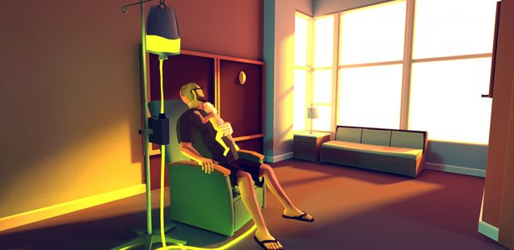
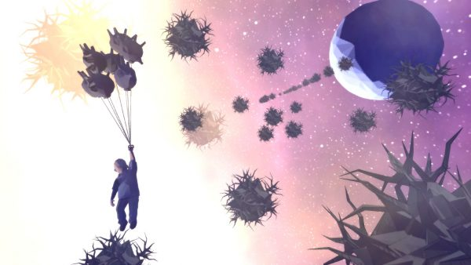
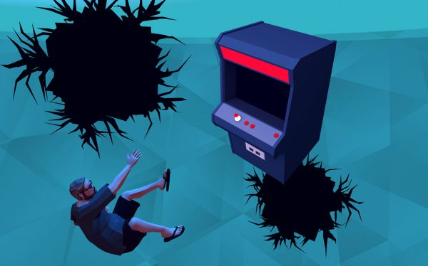
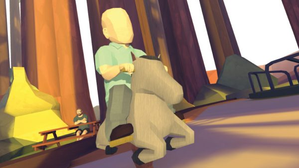

+++
title = "Playing For Real: Slaying Dragons"
template = "mirror.html"
extra.source_url = "http://www.haywiremag.com/columns/slaying-dragons/"
extra.resolved_url = "https://haywiremag.com/columns/slaying-dragons/"
extra.captured = "2026-10-20"
extra.kind = "article"
extra.raw_response = "source.html.txt"
+++

### Jesse Porch thanks you for playing.

One wonderful benefit of videogames is that they let us simulate basically anything; I’ve saved princesses, slayed demons, carefully sown a season’s crops, and stripmined asteroids, all without leaving the comfort of my computer screen. They can implement complex algorithms that try to approximate reality in extreme detail, or eschew accuracy for stylized presentations that encapsulate the feelings of an experience more than its mechanics. Typically, games are designed to make us feel powerful and heroic, often taking liberties to make the horrific and the quotidian alike seem exciting and engaging. Yet with a renaissance of new genres and game design philosophies in recent years, it seems that more designers and players are realizing that there exists a meaningful niche for videogames to communicate a variety of messages in ways that are decidedly not fun.

One such example, *That Dragon, Cancer,* is an autobiographical “notgame” created to share one family’s journey of dealing with their four-year-old son Joel’s (eventually terminal) brain cancer diagnosis. It was recently honored in the “Games for Impact” category of The Game Awards, and during his [acceptance speech](https://www.youtube.com/watch?v=X9D8Hux9IQI) the game’s creator Ryan Green powerfully expressed the paradox of being a storyteller caught telling a story he wished he didn’t have to:

> “Often in videogames we get to choose how we’re seen. Our avatars and our tweets and the work that we do are all meant to portray the story that we want to tell the world about why our lives matter. But sometimes a story is written onto us, or it’s told because of us or in spite of us, and it reveals our weaknesses, our failures, our hopes, and our fears. You let us tell the story of my son Joel, and in the end it was not the story that we wanted to tell.”

Ryan knew first hand the sense of hopelessness that came with facing this sort of dragon, and the game seeks to convey that honestly instead of cloaking it behind a veneer of empowering “game logic.” Rather than attempting to present a framework that enables the player to triumph and defeat their foe, *That Dragon, Cancer* presents a series of poignant episodes from the Green family’s struggles, poetically embellished to portray their emotional toll.

In some cases, common game mechanics are borrowed but subverted—for instance, they lack any way to “win.” Instead, common gaming tropes are  re-purposed to convey the sense of frustration Joel’s parents felt when faced with their own powerlessness. One particularly moving scene involves the player wandering around an empty hospital room while the sound of Joel’s crying mixes with Ryan’s voice trying fruitlessly to calm his son. Several objects are available for interaction in classic puzzle game form, but regardless of what the player does the crying continues unabated. Eventually, Ryan collapses into a strained prayer, at which point the crying suddenly ceases. Despite the player’s best efforts, the situation is not a puzzle that can be solved, and playing through the scene gives a tangible weight to Ryan’s feeling of powerlessness.

This stands in stark contrast to popular titles like *Titanfall 2* that focus on giving the player simulations of power outside of their typical experience. These rightly-termed “power fantasies” tap into an important component of human nature, giving us exciting ways to experience sorts of agency that would never be possible in real life. The fictional nature doesn’t negate the fact that we experience real emotions in response to our “adventures.” Recognizing this quality, videogame theorist Jesper Juul coined the term “half-real” to refer to the fact that interacting with a game consists of an actual experience supported by an imaginary context.

It is for precisely this reason that works such as *That Dragon, Cancer* play an important role in rounding out the experiences offered by modern-day gaming. As described above, rather than presenting a power fantasy, *TDC* boldly opts for the opposite: disempowering the player to draw them into the depth of the author’s struggles. In doing so it undermines the notion that a game is for the player to exert dominance over the story, instead inviting us to truly share in their pain rather than merely observing it. *Call of Duty 4* uses a similar method to raise the stakes in its narrative, following a typical “leave no man behind” hero sequence with an unexpected first-person death scene. By stripping the player of the power they’d become so accustomed to, the game is able to make a striking statement about the nature of the war fetish that most of the genre—even most of *CoD 4* itself—tends to take for granted.

*That Dragon, Cancer* intentionally presents players with scenarios that offer us little agency, challenging us to experience not a pleasurable fantasy, but to engage directly with another family’s reality of loss. Thus as we willingly accept the restrictions that game imposes upon us and enter into a story we don’t particularly wish to experience, we join in the Greens’ pain in a powerful and moving way—the pain of experiencing a story that is difficult to hear mirrors the Greens’ struggle in telling it . This effect is opposite that of a power fantasy: by sharing in someone else’s sense of helplessness, we are drawn further into connection with their situation and their pain. This is what Ryan found so important about the experience he wished to convey, summed up in the conclusion of his speech at The Game Awards:

> “But you chose to love us through our grief by being willing to stop, and to listen, and to not turn away. To let my son Joel’s life change you because you chose to see him, and to experience how we loved him. And I have hope that when we are all willing to see each other not just for who we want to be, but who we are and who we’re meant to be, this act of love and this act of grace can change the world.”

As I’ve said [before](https://haywiremag.com/columns/playing-for-real-let-there-be-play/), [several times](http://www.firstpersonscholar.com/free-to-be-useless/), I believe the beauty of play is that it can be deeply meaningful without needing to depend on some useful outcome. *That Dragon, Cancer*, serves as a prime example of this principle in action—it neither neither tries to fully convey the experience of losing a child nor looks to teach a lesson about how to handle it. Rather, it stands as an honest expression of one family’s struggles and the ensuing emotions: grief, hope, faith, doubt, loneliness, and the joy of being together with loved ones even in the midst of struggle. It does this by being painfully honest and awkwardly intimate, bordering on voyeuristic, all while inviting the player to simply come and be present with the Green family.

While most games offer entertainment by inviting us to come and be something more than we are—stronger, faster, more heroic—*That Dragon, Cancer* boldly opts to constrain the player’s options. In doing so, it tells a story that is both more honest and more human than yet another power fantasy that dresses war in a fresh coat of paint to make it seem appealing. The result is something much more valuable than just another artifact of entertainment, and Ryan, his family, the whole Numinous Games team, and everyone thanked at the start of Ryan’s speech have done the medium and the world a great service by bringing it into existence.

*Author’s note: I am deeply appreciative of Josh Larson, co-developer of* That Dragon, Cancer*, whose thoughtful comments during several conversations last year laid the foundations for this piece.*

---

*Jesse Porch is a software developer who enjoys dabbling in videogame scholarship, especially the cultural role of play in ethics, empathy, and relationships. Check out his other work* [*here*](http://www.jmporch.com/)*.*
