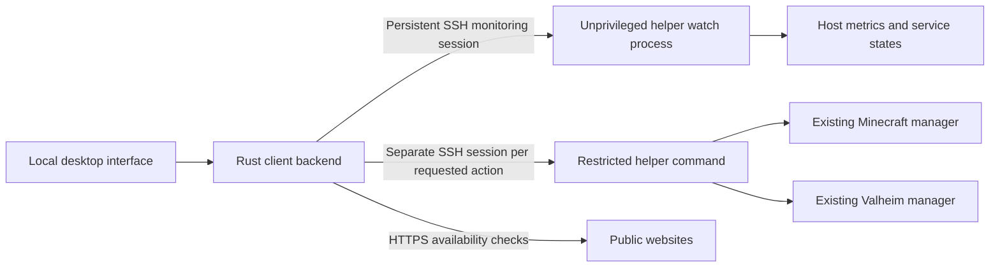

# BackPorch Monitor design

Historical design agreed on November 25, 2026. For the current implementation
and runbooks, see the separate BackPorch Monitor repository.

Build a small desktop application for monitoring the jmporch.com Linux host
and operating its Minecraft and Valheim servers. The application connects
through existing SSH access, uses the installed game managers, and runs only
on selected personal computers. Everyday operation requires no sudo password.

## Scope and destinations

| Component | Target |
| --- | --- |
| Server | Existing Linux x86-64 host at `23.92.22.231` |
| Mac client | Apple Silicon macOS |
| Windows client | Windows x64 |
| Website checks | `https://jmporch.com/` and `https://haywiremag.com/` |
| Minecraft | `minecraft.service`, existing `minecraftctl`, data under `/minecraft` |
| Valheim | `valheim.service`, existing `valheimctl`, data under `/valheim` |
| Web server | `nginx.service`, monitoring only |

The first version includes CPU, memory, disk and uptime monitoring, service
status, website availability, game start/stop controls, and recent game logs.
It retains a rolling hour of resource history while the application is open.

NGINX serves both websites. Display their HTTPS health separately from the
shared NGINX process state: a running process alone does not establish that a
website is reachable from the client.

World generation, switching, deletion, import/export, backups on demand, game
updates, password editing, service restart buttons, server reboot, NGINX
controls, and general terminal access are outside the first version. Existing
CLI tools remain available for those tasks. The helper invokes only the existing start/stop commands and adds no backup
step. Valheim currently backs up during stop; Minecraft backup behavior remains
the responsibility of its own manager.

## Implementation

| Part | Implementation |
| --- | --- |
| Desktop application | Tauri 2 |
| Interface | TypeScript, HTML and CSS bundled with the application |
| Client backend | Rust for SSH processes, connection lifecycle and local state |
| Server helper | Rust command-line executable |
| Shared protocol | Rust crate defining commands, statuses, errors and JSON messages |
| Administrator installer | Bash for account, files and narrow sudo permissions |
| Existing game managers | Retain the installed Python implementations |

Use a Cargo workspace for the desktop backend, helper and shared protocol.
Keep the desktop toolchain isolated from the Zola website build. The Rust
helper invokes the existing Python game managers under their respective
accounts; their world handling, graceful shutdown and existing backup behavior remain
the authority for game operations.

Rust allows the client and helper to share protocol types and validation and
provides a compiled helper artifact. It requires an additional Linux build and
test target. Resource sampling is small enough that language performance is
not a deciding factor; permission boundaries and command validation provide
the important security protections.

## Connection architecture

The backend launches the machine's installed OpenSSH client. On Windows this
is the OpenSSH client executable; on macOS it is the system SSH client. Check
availability during setup and report a useful error if it is missing.

There is one persistent monitoring SSH session per running desktop client.
That session launches the helper in watch mode. Every five seconds the helper
collects a snapshot and writes a newline-delimited JSON message to standard
output. The desktop backend reads the stream and updates the interface and
history. It does not establish a new SSH connection for each sample.

Start, stop and requested log retrieval each use a separate, short-lived SSH
session. Long game startup or shutdown must not block monitoring. Logs are
retrieved on demand as a bounded snapshot; continuous log streaming is outside
the initial scope.

All management traffic uses the existing SSH port. The helper has no listening
management port and is not an always-running systemd service. A watch process
exists only for its SSH session; disconnect or application exit must terminate
it. Closing the desktop app must not stop a game service or cancel an already
accepted server control operation.

## SSH identity and permissions

Each installation selects an SSH configuration entry for the same Linux host.
Use the user's existing configured key or SSH agent. Do not bundle, upload,
copy into app storage, or synchronize private keys or passphrases. Each other
machine can use its own authorized key. Passphrase unlocking remains with
the operating system or SSH agent; verify GUI access to the agent on both
supported client platforms.

Preserve SSH host-key verification. Reuse a verified known-host entry or perform
an explicit first-use fingerprint verification. A changed host key is a
connection error, never a reason to silently bypass verification. Agent
forwarding is unnecessary and should be disabled for these connections.

Install a dedicated operator account and a root-owned helper executable.
Read metrics and ordinary service state without elevation. Allow only the
specific privileged operations needed to invoke each game's manager as its
game account and retrieve its approved logs. Everyday operations must work
noninteractively without granting general sudo access.

Validate service names, actions and all other arguments at the server boundary.
NGINX is a read-only target. Execute fixed program paths with argument arrays;
do not construct shell commands from interface values. Neither the interface
nor the SSH account receives an arbitrary privileged command facility. The
operator must not be able to replace helper code, service units or sudo rules.

Do not send game passwords, private configuration files, SSH credentials or
complete process command lines to the client. Redact known secrets from game
log responses before displaying or retaining them. Keep local connection
settings separate from the bundled application and store no credentials there.

## Monitoring and history

The initial sampling interval is five seconds. Use these definitions:

| Metric | Meaning |
| --- | --- |
| CPU | Host-wide utilization calculated from successive Linux CPU-counter samples |
| Memory | Total, available, and used memory; used is total minus available |
| Disk | Used/free bytes and percentage for relevant filesystems |
| Uptime | Host uptime |
| Services | Minecraft, Valheim and NGINX state with useful failure details |

Read Linux metrics from local kernel interfaces and filesystem statistics.
Include the root filesystem and any distinct filesystem containing website,
Minecraft or Valheim data. Deduplicate paths on the same filesystem so one
disk is not presented as several independent capacities.

Keep resource samples in a bounded, in-memory buffer covering the most recent
hour, approximately 720 snapshots at the default interval. Each client owns
its history independently. Closing the app discards that history. Do not
backfill gaps after sleep, lost connectivity or app closure. Show unavailable
initial CPU samples and disconnected intervals as gaps rather than zeros.

Each snapshot includes a server timestamp, sequence number, protocol version
and service states. Track local receipt time independently for freshness.
Use monotonic elapsed time for interval calculations and stale-data detection.

Check the two public HTTPS URLs from the client periodically with bounded
timeouts, using fifteen seconds as the initial implementation default. Validate
TLS certificates and report HTTP failures separately from SSH or service
failures. Website checks are ordinary public requests and need no credentials.

## Service controls

Display one card or row for each game, with its current state, an applicable
Start or Stop button, and a recent-logs action. Display NGINX status without
control buttons. Controls must reflect fresh server state, not remembered
client assumptions.

| Observed state | Interface behavior |
| --- | --- |
| Stopped | Show Start |
| Running | Show Stop |
| Starting or stopping | Show progress and disable conflicting controls |
| Failed with no remaining process | Show failure details and allow a validated Start |
| Unknown or stale | Show unavailable state and disable changes until reconciled |

A failed systemd unit can have no running process, as previously observed after
Minecraft's Java shutdown. Use unit state and remaining main/control processes
to distinguish a stopped failed unit from a live or transitioning service.

Start and stop operate on the selected game. Both games can run together.
Stop requires confirmation in the desktop app. The helper validates the
requested service state and waits for its manager to complete.

Serialize desktop control operations across clients with the server-side
operation lock. Monitoring remains available while a control operation runs.
Existing game CLIs can still change state, so the helper checks the target
again when validating the result.

## Operation protocol and recovery

Use versioned JSON messages shared by the Rust components. Provide typed
operations for watch/status, start, stop, recent logs and operation-status
reconciliation. A game action names one target.

Bound message sizes, log output and request frequency. Separate protocol output
on standard output from diagnostics on standard error. Return structured errors
for authentication, protocol incompatibility, service conflicts, permissions,
startup failure, timeout and unavailable metrics.

Assign each accepted control operation an identifier and retain bounded operation
state on the server. An accepted operation must survive loss of its requesting
SSH connection and record its eventual result. Use a short-lived systemd job or
equivalent bounded worker for that lifetime; this does not require a persistent
management daemon. Select and test the exact mechanism during implementation.
If transient systemd jobs are used, the privileged helper constructs their fixed
execution parameters; the operator receives no general `systemd-run` permission.

On connection loss, mark monitoring stale and reconnect with exponential backoff,
initially one second and capped at thirty seconds. SSH keepalives and connection
timeouts must detect dead sessions. Establish a fresh snapshot after reconnect
before enabling controls. Incompatible protocol versions produce an explicit
upgrade message.

Do not automatically repeat an interrupted start/stop request. Reconcile its
operation identifier and current server state after reconnecting. If acceptance
is uncertain, show that uncertainty and inspect server state before allowing
another action. Timeouts are not proof that a game stopped or that a command
failed. Operation progress and limits must accommodate multi-minute world
creation and graceful shutdown; do not force-kill a game to satisfy a UI timeout.

## Interface and distribution

Use one modest window containing connection status and last-update time,
resource readings with simple hour-long charts, website/NGINX health, the two
game controls, and a bounded recent-log view. Show actionable error details and
operation progress without requiring a terminal for ordinary use.

Monitoring runs while the application is open. Initial scope excludes tray-only
monitoring, scheduled actions, remote notifications, durable metric archives,
multiple host profiles, and automatic application updates. Application and helper
release updates use manually installed versioned builds initially.

Produce macOS ARM64 and Windows x64 client packages and a Linux x64 helper.
Test the helper on the target Ubuntu environment. Building the Mac client does
not itself validate the Windows client or Linux helper. Confirm distribution
signing requirements during packaging; keep signing credentials outside source.

## Installation and validation

Prepare the local app, helper, tests and reviewed installer before changing the
host. The one-time administrator installation creates the operator account,
installs public keys and root-owned files, and validates restricted sudo rules.
Routine client and helper installation must not require a website or game
restart. Preserve the existing games' disabled-at-boot policy. Merely opening
the app starts neither game.

Validate at least these behaviors before release:

- Metrics, filesystem deduplication, bounded history and freshness handling.
- SSH configuration and agent access on Apple Silicon macOS and Windows x64.
- Host-key mismatch, unavailable key, network loss, sleep/resume and reconnect.
- Working metrics throughout a slow game start or graceful stop.
- Independent start and stop with both games running and manager completion.
- Concurrent requests from two clients and intervening changes from the CLI.
- A failed control action leaves the other game untouched.
- Operation completion and reconciliation after the requesting client disconnects.
- NGINX monitoring without permission to control it.
- Argument allowlists, malformed messages, output limits and secret redaction.
- Protocol-version mismatch and manually installed helper/client upgrades.

Stage the administrator installation for review and provide the necessary sudo
command when implementation is ready. Installing the helper must not broaden
the operator account into general host administration.

## References

- [Existing Minecraft operations](minecraft.md)
- [Existing Valheim operations](valheim.md)
- [Production web server layout](new-server-testing.md)
- [Tauri documentation](https://v2.tauri.app/)
- [Cargo workspaces](https://doc.rust-lang.org/cargo/reference/workspaces.html)
- [OpenSSH client configuration](https://man.openbsd.org/ssh_config)
